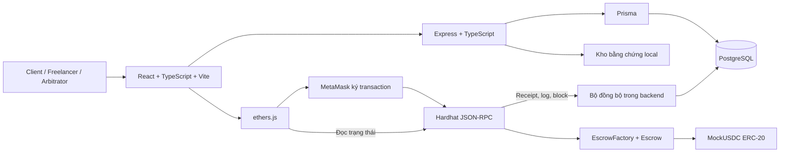
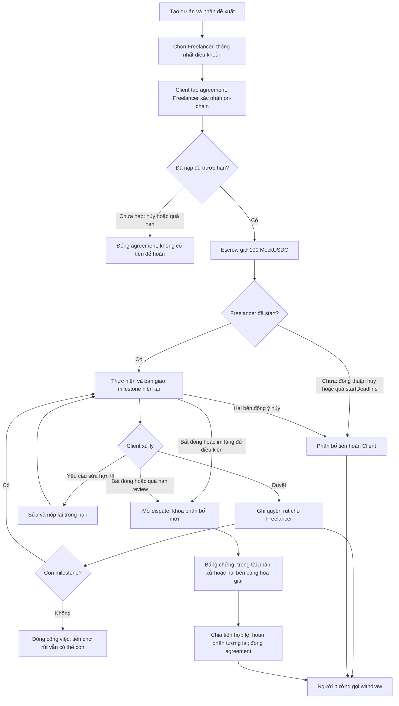

# Giai đoạn 1 — Phân tích bài toán và phạm vi MVP

Ngày lập: 31/10/2026, múi giờ Asia/Saigon.

Trạng thái: **Đã có bản phân tích và người học đã yêu cầu tiếp tục Giai đoạn 2**. Chưa triển khai quy tắc dưới đây thành smart contract; các mặc định được dùng làm giả định làm việc, chưa coi là người học đã xác nhận từng chi tiết. Xem [đặc tả Giai đoạn 2](02-yeu-cau-va-use-case.md).

## 1. Mục tiêu và điều kiện đầu vào

Kết quả cần đạt: hiểu ai giữ tiền, ai quyết định tiền đi đâu, phạm vi đồ án và cách kiểm chứng luồng tiền. Giai đoạn này tạo tài liệu, không yêu cầu viết code ứng dụng.

Đã kiểm tra trực tiếp trong repository:

| Thành phần | Kết quả |
| --- | --- |
| Git | Đã có repository và commit `92495de`; không cần `git init` lại |
| Runtime trên máy | Node.js `v24.14.0`, npm `11.9.0`, Git `2.46.1.windows.1` |
| Frontend | Có React, TypeScript, Vite và CSS thường; chưa có Tailwind trong package.json |
| Lưu dữ liệu | `src/App.tsx` dùng dữ liệu mẫu và localStorage |
| Blockchain/backend/database | Chưa có mã triển khai trong cấu trúc hiện tại |
| Mức xác minh | Đã đọc mã và kiểm tra phiên bản; chưa cài dependency, chạy UI hoặc kiểm tra build |

Các tệp frontend đang chưa được Git theo dõi tại thời điểm kiểm tra. Giữ nguyên trong bước này; chưa tạo commit hoặc thay đổi kiến trúc thư mục.

## 2. Bài toán và giá trị thực tế

Client sợ mất tiền khi công việc chưa hoàn thành. Freelancer sợ giao sản phẩm nhưng không nhận được tiền. Escrow là một chiếc két có quy tắc: Client nạp trước, hệ thống chỉ phân bổ tiền khi có nghiệm thu, thỏa thuận hủy hợp lệ hoặc quyết định phân xử.

Ví dụ xuyên suốt: một website có ba milestone trị giá **30 + 40 + 30 = 100 MockUSDC**. Client ký quỹ 100. Khi milestone 1 được nghiệm thu, Freelancer có quyền rút 30; 70 vẫn bị ràng buộc cho phần công việc còn lại.

Nếu chỉ dùng database, người vận hành có thể sửa bản ghi “đã trả tiền” mà tiền thực chưa chuyển. Smart contract giữ token ở địa chỉ của nó và kiểm tra điều kiện bằng mã thực thi trên EVM. Website/backend không có quyền bỏ qua các kiểm tra đó. Blockchain giúp kiểm chứng luồng token và quyền thực hiện; không chứng minh website bàn giao có chất lượng tốt. Việc đánh giá sản phẩm vẫn cần con người.

Token là bản ghi số dư trong contract ERC-20: nói “tiền nằm trong escrow” nghĩa là `balanceOf(escrowAddress)` trong token contract phản ánh số token escrow đang giữ. Backend không giữ private key của người dùng. Local ETH dùng trả gas, tách biệt với MockUSDC dùng ký quỹ. Cả hai chỉ là tài sản thử nghiệm của mạng local.

## 3. MVP khả thi

| Phần | Đưa vào MVP | Giới hạn để sinh viên triển khai được |
| --- | --- | --- |
| Tài khoản | Đăng ký/đăng nhập, hồ sơ Client/Freelancer, liên kết ví có chữ ký | Một ví xác minh đang hoạt động/tài khoản; không đổi các bên trong agreement đã tạo |
| Dự án | Tạo dự án, đề xuất, chọn Freelancer, xác nhận điều khoản | Một Client và một Freelancer/agreement; dự án chỉ có một agreement có hiệu lực tại một thời điểm |
| Ký quỹ | Một mock ERC-20, nạp đủ tổng giá trị một lần | Chạy local, không đa token, không nạp từng phần, không thu phí nền tảng |
| Milestone | Bắt đầu, bàn giao, yêu cầu sửa, nghiệm thu, rút tiền | Tối đa 10 milestone, thực hiện tuần tự; không làm song song |
| Hủy | Hủy trước nạp; hủy sau nạp theo đồng thuận hoặc điều kiện hết hạn rõ ràng | Không thu hồi khoản đã được phân bổ hợp lệ |
| Tranh chấp | Hai bên mở tranh chấp; bằng chứng; trọng tài phân bổ phần tranh chấp | Một tranh chấp đang mở/agreement; không kháng cáo trong MVP |
| Dashboard | Số dư, tiền chờ rút, đã rút, hoàn tiền, lịch sử, tranh chấp | Hiển thị dữ liệu đã đối soát và cảnh báo khi đồng bộ chậm |
| Kiểm thử | Unit contract, API/integration, đối soát sự kiện | Có cả quyền sai, trạng thái sai, gọi lặp, token bất thường |

Để sau MVP: mainnet, tiền thật, thanh toán thẻ, chat thời gian thực, AI chấm chất lượng, DAO, NFT, upgrade proxy, nhiều chain, nhiều trọng tài và hệ thống kháng cáo. Testnet chỉ cân nhắc sau khi demo local đạt yêu cầu.

Không xem nút đổi vai trò trong UI là phân quyền. Quyền backend phải được kiểm tra bằng session và quyền on-chain phải được kiểm tra bằng địa chỉ người gọi.

## 4. Kiến trúc và lựa chọn công nghệ

Đây là kiến trúc đề xuất, chưa phải thiết kế chi tiết của Giai đoạn 4.



| Lớp | Lựa chọn và lý do |
| --- | --- |
| UI | Giữ React + TypeScript + Vite đang có; thêm Tailwind lúc xây UI để thống nhất style, không đổi framework |
| Giao tiếp chain | ethers.js v6: đọc contract, mã hóa lời gọi và kết nối signer từ MetaMask |
| Blockchain | Solidity trên EVM, Hardhat local; test TypeScript với Mocha/Chai và bộ công cụ ethers tương thích |
| Token | OpenZeppelin ERC-20 tùy biến 6 decimals, tên MockUSDC; không phải USDC thật và không có bảo chứng USD |
| Backend | Node.js + Express + TypeScript, một ứng dụng có API và bộ đồng bộ; chưa cần microservice/queue |
| Database | PostgreSQL + Prisma cho quan hệ user–project–agreement–milestone và migration |
| File | Lưu local ngoài thư mục public, kiểm tra quyền tải và giới hạn dung lượng; hash nội dung được neo on-chain |

Tài liệu Hardhat hiện có hướng dẫn Hardhat 3 và test TypeScript với ethers.js. Chốt bản Hardhat, plugin, Solidity và Node tương thích ở Giai đoạn 5; chưa suy ra rằng các package hiện có đã tương thích toàn bộ. Xem [Hardhat getting started](https://hardhat.org/docs/getting-started) và [ethers v6](https://docs.ethers.org/v6/).

So sánh kiến trúc escrow:

| Cách | Ưu điểm | Nhược điểm / rủi ro | Đề xuất |
| --- | --- | --- | --- |
| Một contract quản lý mọi agreement | Ít lần deploy | Mapping và sổ số dư dùng chung phức tạp; lỗi có phạm vi ảnh hưởng rộng | Không chọn cho bản học đầu tiên |
| Factory tạo một contract/agreement | Dễ đọc số dư và kiểm thử riêng; các bên/điều khoản cố định | Tốn gas deploy hơn, cần index nhiều địa chỉ | Chọn; gas local không phải chi phí thực |
| Proxy/clone | Giảm chi phí deploy | Thêm khởi tạo, storage và rủi ro quyền nâng cấp | Để sau MVP |

Factory chỉ tạo escrow và phát event; không có quyền rút tiền từ escrow. Contract không nâng cấp. Token và trọng tài được cố định cho từng agreement khi tạo.

### Trách nhiệm và nguồn chân lý

- **On-chain:** các địa chỉ có quyền, token, giá trị milestone, thời hạn, hash điều khoản/bằng chứng, trạng thái tài chính, phân bổ tiền, tiền đã rút và event.
- **Backend:** tài khoản/session, kiểm tra quyền API, metadata, upload/download bằng chứng, xác minh chữ ký ví và đồng bộ chain.
- **Database:** User/Profile, Project, Proposal, Agreement/Milestone metadata, Evidence, Dispute và Transaction index. Đây là bản phục vụ truy vấn, không được tự quyết định số dư.
- **Frontend:** hiển thị và yêu cầu ví ký; phân biệt awaiting signature, submitted, mined, confirmed, reverted và lỗi RPC. Lỗi RPC sau khi gửi không chứng minh transaction thất bại; cần tra receipt/hash trước khi thử lại.

Backend xác minh receipt thành công, chain, địa chỉ contract, event và số block xác nhận. Không ghi “thành công” chỉ vì frontend gửi hash. Index phải chống trùng bằng chainId/txHash/logIndex, lưu blockHash và con trỏ đồng bộ, hỗ trợ quét bù và xử lý chain reset/reorg. Local mặc định 1 confirmation cho demo; số này không bảo đảm finality trên mạng công khai. Thiết kế chi tiết ở các giai đoạn sau.

## 5. Quyết định nghiệp vụ cần chốt trước code

Các giá trị sau là **mặc định đề xuất**, chưa coi là người học đã xác nhận. Giai đoạn 3 sẽ chuyển chúng thành bảng chuyển trạng thái và điều kiện thời gian chính xác.

| Quyết định | Mặc định đề xuất |
| --- | --- |
| Giá trị | MockUSDC có 6 decimals; lưu số nguyên, ví dụ 30 token = 30.000.000 đơn vị; tổng milestone bằng tổng agreement, mỗi milestone > 0 |
| Các bên | Ba địa chỉ Client, Freelancer, Arbitrator khác nhau và khác địa chỉ 0; không đổi người nhận/token/trọng tài sau tạo |
| Chấp nhận | Client tạo agreement on-chain với hash điều khoản; Freelancer xác nhận đúng hash on-chain; sau đó mới cho fund |
| Điều khoản cố định | Địa chỉ các bên, giá trị/thứ tự, deadline, cửa sổ review/revision, chính sách hủy và phân xử được khóa từ khi tạo; muốn đổi thì hủy agreement chưa nạp và tạo lại |
| Funding | Client approve đúng số token cần thiết, rồi fund đủ một lần; contract đối chiếu chênh lệch số dư nhận thực với tổng phải nạp; không nhận token có phí/rebase trong MVP |
| Hạn funding | 48 giờ từ tạo; sau đó không được nạp, một trong hai bên có thể đóng agreement chưa nạp; không tự chạy nếu không có transaction |
| Bắt đầu | Freelancer gọi start trước hoặc tại startDeadline cố định; đề xuất startDeadline = fundDeadline + 7 ngày; deadline milestone đầu phải sau startDeadline |
| Milestone | Thực hiện lần lượt; chỉ milestone hiện tại được bắt đầu/bàn giao/nghiệm thu; milestone sau chờ milestone trước được xử lý xong |
| Nghiệm thu | Client có 72 giờ kể từ bàn giao để duyệt, yêu cầu sửa hoặc mở tranh chấp; không tự động trả tiền nếu Client im lặng |
| Sửa đổi | Tối đa 2 lần/milestone; mỗi lần có 72 giờ để nộp lại. Client yêu cầu sửa phải kèm lý do/hash. Hết lượt thì duyệt hoặc tranh chấp |
| Deadline | Deadline milestone tăng dần và cố định trước ký quỹ; sau khi đã yêu cầu sửa hợp lệ, hạn sửa được ưu tiên cho lần nộp lại; không hủy ngay chỉ vì quá hạn |
| Hủy trước nạp | Client hủy agreement chưa nạp; không có tiền escrow để hoàn; không xóa lịch sử |
| Hủy sau nạp, chưa start | Hai bên đồng thuận thì hủy ngay; nếu chưa start và đã quá startDeadline, Client được đóng và phân bổ toàn bộ phần chưa sử dụng để hoàn |
| Hủy sau start / sau trả một phần | Hai bên xác nhận cùng yêu cầu hủy on-chain; nếu chưa có tranh chấp thì phần chưa phân bổ được hoàn Client. Mọi bàn giao đang chờ phải được hai bên chấp thuận xử lý trong yêu cầu hủy; một bên không đồng ý thì đi tranh chấp |
| Hiệu lực đồng thuận hủy | Mỗi yêu cầu có nonce, hash trạng thái hiện tại và thời hạn; bàn giao, nghiệm thu, yêu cầu sửa hoặc mở tranh chấp làm vô hiệu yêu cầu cũ; không dùng lại một lần đồng ý cũ để hủy sau thay đổi |
| Một bên im lặng | Hết review window: Freelancer được mở tranh chấp; quá hạn công việc/sửa thêm 72 giờ: Client được mở tranh chấp. Nếu yêu cầu hủy đang chờ và quá 72 giờ: một bên được mở tranh chấp. Không tự thu hồi hay tự trả tiền chỉ vì im lặng |
| Mở tranh chấp | Client/Freelancer của escrow được mở đối với milestone hiện tại đã start và chưa phân bổ, hoặc trường hợp bế tắc hủy hợp lệ; cần lý do/hash; chỉ một tranh chấp mở/agreement |
| Phạm vi khóa | Khóa mọi phân bổ mới và hủy trong agreement khi tranh chấp mở; vẫn cho rút khoản đã phân bổ hợp lệ trước đó. Thiết kế tuần tự này đơn giản hơn cho nhiều milestone chạy đồng thời |
| Phân xử | Trọng tài cố định chỉ chia số tiền của milestone đang tranh chấp giữa hai bên; tổng chia phải đúng số đó, không có người nhận thứ ba, không đụng khoản đã phân bổ |
| Sau phân xử | Milestone tranh chấp thành terminal; mặc định chấm dứt phần công việc còn lại và phân bổ phần chưa sử dụng của milestone tương lai để hoàn Client; không tiếp tục quan hệ đang tranh chấp trong MVP |
| Trọng tài im lặng | Hai bên vẫn có thể cùng xác nhận một thỏa thuận kết thúc, chia đúng phần chưa phân bổ bằng transaction on-chain với nonce/hash/thời hạn; không bên nào tự lấy hết. Nếu cả trọng tài và một bên im lặng, tiền chưa phân bổ có thể bị kẹt; công bố giới hạn này, chưa có trọng tài dự phòng trong MVP |
| Rút tiền | Pull-payment: nghiệm thu/phân xử/hoàn tiền ghi quyền rút; chính người hưởng gọi withdraw để chuyển token về địa chỉ cố định của mình |
| Bằng chứng | File/mô tả ở backend có kiểm soát truy cập; hash nội dung và mốc thao tác quan trọng on-chain; hash giúp phát hiện sửa file, không chứng minh chất lượng hay bảo đảm file luôn còn |
| Ví | Challenge gắn account, session, ví, domain, chainId, nonce ngẫu nhiên, issuedAt và expiration 5 phút; backend xác minh chữ ký và tiêu thụ nonce nguyên tử một lần; MVP chỉ ví EOA |
| Admin | Admin web không được rút token; ví Arbitrator chỉ thực hiện phân xử hợp lệ. DB role không thay thế quyền địa chỉ on-chain |

Ngoại lệ đồng thuận kết thúc khi đang tranh chấp phải phân bổ toàn bộ phần chưa phân bổ trong cùng một thao tác, đóng dispute, vô hiệu yêu cầu cũ và không chạm tiền chờ rút. Đây là lối thoát do cả hai bên đồng ý, không phải quyền rút của Admin.

Các điều kiện ranh giới đề xuất: thao tác đúng hạn dùng `timestamp <= deadline`, thao tác hết hạn dùng `timestamp > deadline`. Nếu hai transaction cạnh tranh, transaction thực thi trước thay đổi trạng thái; transaction sau phải kiểm tra lại và revert nếu điều kiện không còn đúng. Kiểm thử ranh giới sẽ thực hiện ở Giai đoạn 7.

### Quyền và rủi ro trọng tài

Client quyết định nghiệm thu theo điều khoản; Freelancer bàn giao; trọng tài đánh giá tranh chấp ngoài đời và phân bổ khoản được phép. Trọng tài có thể thiên vị trong phạm vi đó. Contract giới hạn số tiền/người nhận, nhưng không bảo đảm quyết định công bằng. Không kết luận hệ thống an toàn tuyệt đối từ vài bài test.

SafeERC20 xử lý token trả false hoặc không trả dữ liệu theo hành vi được thư viện hỗ trợ; nó không tự sửa token độc hại, phí chuyển hay rebase. Cần kiểm tra số dư nhận thực tế, token cố định và kiểm thử. Khi viết contract sẽ kết hợp kiểm tra quyền/trạng thái, Checks–Effects–Interactions và ReentrancyGuard. Tham khảo [OpenZeppelin ERC-20/SafeERC20](https://docs.openzeppelin.com/contracts/5.x/api/token/erc20) và [Solidity Security Considerations](https://docs.soliditylang.org/en/latest/security-considerations.html).

## 6. Luồng nghiệp vụ dự kiến



Đây là luồng cấp cao, không phải state machine hoàn chỉnh. Giai đoạn 3 sẽ chốt trạng thái agreement và milestone riêng, bảng quyền và mọi chuyển trạng thái, kể cả trường hợp lỗi.

### Luồng một transaction nghiệm thu

1. Freelancer lưu file/mô tả qua API; hash bằng chứng được ghi nhận bằng transaction bàn giao. Upload thành công chưa có nghĩa milestone đã bàn giao on-chain.
2. Client xem sản phẩm và gọi approve milestone từ website. MetaMask hiển thị lời gọi để Client ký bằng private key trong ví; website không cần biết private key.
3. Transaction được gửi qua RPC, có hash, chờ đưa vào block. EVM kiểm tra người gọi là Client, đã fund, milestone đang Submitted, không có dispute và chưa phân bổ.
4. Nếu hợp lệ, contract ghi quyền rút, cập nhật trạng thái và phát event. Nếu revert, không ghi phân bổ; phí gas vẫn có thể bị tiêu thụ trên mạng có tính phí.
5. Backend xác minh receipt/log và cập nhật database theo số confirmation cấu hình. Frontend đọc lại trạng thái on-chain; không tự đặt Paid từ một phản hồi API.
6. Freelancer ký transaction withdraw riêng. Contract giảm quyền rút trước khi chuyển token. Chỉ lúc withdraw thành công mới báo “đã nhận về ví”.

## 7. Bất biến và ví dụ đối soát

Ký hiệu: `D` tổng nạp được ghi nhận; `U` tiền chưa phân bổ; `C` tổng quyền rút chưa thực hiện; `Wf` tiền Freelancer đã rút; `Wc` tiền Client đã rút hoàn.

```text
D = U + C + Wf + Wc
balanceOf(escrow) >= U + C
Wf + Wc <= D
```

Với token mock chuẩn và không có ai chuyển trực tiếp thêm token, số dư escrow bằng `U + C`. Nếu có chuyển token trực tiếp vào địa chỉ escrow, khoản dư không tự tạo quyền rút và không tăng D. MVP không có hàm Admin quét số dư dư thừa; không nhầm số dư thực với nghĩa vụ tài chính.

| Thời điểm | D | U | C | Wf | Wc | Số dư escrow dự kiến |
| --- | ---: | ---: | ---: | ---: | ---: | ---: |
| Nạp đủ | 100 | 100 | 0 | 0 | 0 | 100 |
| Nghiệm thu milestone 1 | 100 | 70 | 30 | 0 | 0 | 100 |
| Freelancer rút | 100 | 70 | 0 | 30 | 0 | 70 |
| Hai bên hủy phần còn lại | 100 | 0 | 70 | 30 | 0 | 70 |
| Client rút hoàn | 100 | 0 | 0 | 30 | 70 | 0 |

Nhánh tranh chấp thay cho hủy: sau khi Freelancer đã rút 30, milestone 2 trị giá 40 tranh chấp. Trọng tài chia 15 cho Freelancer, 25 cho Client; milestone 3 chưa làm hoàn 30 cho Client. Kết quả sau khi rút hết: Freelancer nhận 45, Client nhận lại 55, escrow còn 0. Trọng tài không được chia 41 cho milestone 40 hoặc thu hồi 30 đã phân bổ trước đó.

Bất biến khác: milestone đã terminal không phân bổ lại; mỗi yêu cầu hủy/hòa giải chỉ dùng một lần; không fund hai lần; không đổi bên nhận; không phân bổ khi dispute mở trừ đúng phương thức giải quyết; đóng agreement không vô hiệu quyền rút đã có.

## 8. Bước đầu tiên người học thực hiện

**Mục tiêu:** diễn giải đúng một giao dịch và xác nhận các mặc định nghiệp vụ trước khi viết đặc tả.

1. Mở tài liệu này và đọc ví dụ 100 = 30 + 40 + 30.
2. Tự tính lại hai nhánh: nghiệm thu 30 rồi đồng thuận hủy; nghiệm thu 30 rồi tranh chấp 40 chia 15/25 và hoàn milestone tương lai 30.
3. Ghi câu trả lời: tiền nằm ở đâu, ai cho phép rút, vì sao Admin không có quyền tự lấy tiền, upload bằng chứng khác bàn giao on-chain thế nào.
4. Xem bảng quyết định. Xác nhận mặc định hoặc gửi những dòng muốn thay đổi, đặc biệt: 72 giờ review, tối đa 2 lần sửa, trọng tài cố định, không tự trả khi im lặng, chấm dứt sau phân xử.
5. Gửi kết quả để bắt đầu Giai đoạn 2. Không cần cài thêm package ở Giai đoạn 1.

Nếu muốn tự kiểm tra môi trường, chạy **PowerShell tại `D:\git_hub\BlockChain\BlockChain__`**:

```powershell
Set-Location -LiteralPath 'D:\git_hub\BlockChain\BlockChain__'
git status --short
node --version
npm --version
Get-Content -LiteralPath '.\docs\01-mvp-va-nghiep-vu.md' -Encoding utf8
```

Kết quả mong đợi: Git nhận đúng repository; Node/npm in phiên bản (máy hiện tại là 24.14.0/11.9.0); đọc được tài liệu tiếng Việt. Đây là kiểm tra đầu vào, không phải kiểm thử ứng dụng hay bằng chứng contract đã chạy.

### Cấu trúc và phần được tạo trong bước này

```text
README.md                         Điểm bắt đầu và trạng thái thực tế
docs/01-mvp-va-nghiep-vu.md        Toàn bộ nội dung Giai đoạn 1
```

Không có code ứng dụng cần bổ sung hoặc giải thích theo khối trong bước phân tích. Code Solidity/backend sẽ được viết trọn phần đang học ở giai đoạn tương ứng, sau khi state machine và môi trường sẵn sàng.

### Kiểm tra, lỗi thường gặp và cách sửa

| Hiện tượng | Nguyên nhân cần kiểm tra | Cách xử lý ở bước này |
| --- | --- | --- |
| `not a git repository` | Terminal đứng sai thư mục | Chạy Set-Location bằng đường dẫn trên rồi thử lại |
| Không tìm thấy node/npm | Chưa cài hoặc PATH terminal cũ | Gửi nguyên lỗi; xử lý môi trường ở Giai đoạn 5 trước khi chạy ứng dụng |
| PowerShell chặn `npm.ps1` | Execution policy của máy | Thử `npm.cmd --version`; không tự nới lỏng policy toàn máy |
| Tiếng Việt hiển thị sai | Đọc sai encoding | Dùng `Get-Content -Encoding utf8` hoặc editor UTF-8 |
| Không thấy sơ đồ đồ họa | Trình xem Markdown không hỗ trợ Mermaid | Đọc các nhánh dạng chữ trong khối Mermaid; không phải lỗi nghiệp vụ |
| UI báo Confirmed nhưng không có receipt | UI đang sinh hash demo bằng JavaScript | Chưa xem đó là thanh toán thật; chỉ nghiệm thu sau bước kết nối chain và đối soát |
| Số dư demo sai sau hoàn tiền | Prototype chưa có sổ phân bổ/rút/hoàn đầy đủ | Dùng bảng đối soát trên làm tiêu chí khi triển khai; chưa lấy localStorage làm sổ tiền |

### Tiêu chí hoàn thành Giai đoạn 1

- Người học giải thích được khác biệt giữa lưu database, phân bổ on-chain và chuyển tiền về ví.
- Phạm vi MVP và các phần để sau được chấp nhận hoặc có danh sách điều chỉnh.
- Hai ví dụ tiền đều cộng đủ 100; không hoàn khoản đã trả và không phân bổ hai lần.
- Đã đọc và xác nhận hoặc sửa các quy tắc thời hạn, hủy, sửa đổi và tranh chấp.
- Hiểu giới hạn tin cậy trọng tài và rủi ro kẹt tiền khi không ai giải quyết được.
- Người học gửi kết quả trước khi chuyển Giai đoạn 2.

## 9. Tài liệu chính thức đã đối chiếu

- [Hardhat — Getting started](https://hardhat.org/docs/getting-started): lựa chọn Hardhat và đường dẫn hướng dẫn test ethers/TypeScript.
- [ethers v6](https://docs.ethers.org/v6/): thư viện tương tác Ethereum và ví.
- [OpenZeppelin — ERC20](https://docs.openzeppelin.com/contracts/5.x/api/token/erc20): ERC-20, decimals và SafeERC20.
- [Solidity — Security Considerations](https://docs.soliditylang.org/en/latest/security-considerations.html): reentrancy và thứ tự kiểm tra/cập nhật/gọi bên ngoài.

Các deadline, giới hạn milestone và quy tắc phân xử trong tài liệu này là quyết định thiết kế đề xuất cho đồ án; không phải quy tắc có sẵn của Ethereum hay OpenZeppelin.
