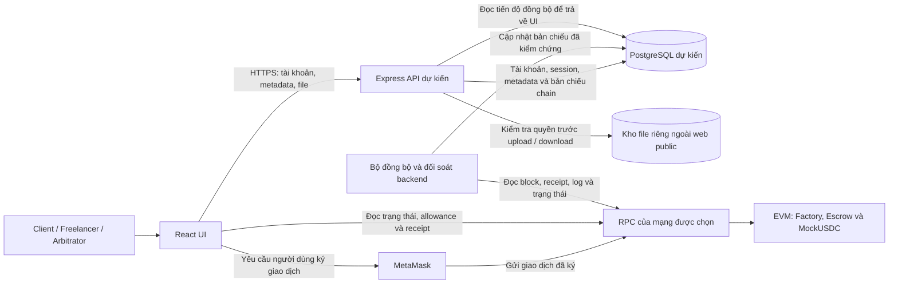
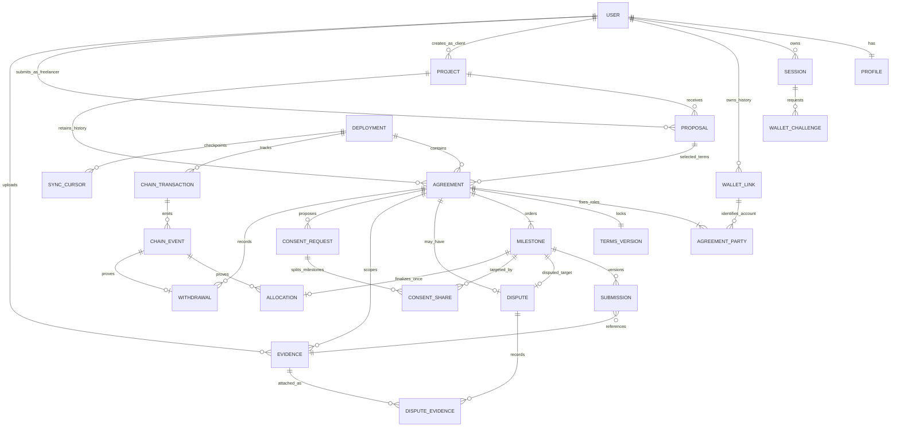

# Giai đoạn 4 — Kiến trúc chi tiết, ERD và luồng giao dịch

**Phạm vi đã có:** mục 1 — sơ đồ thành phần và ranh giới trách nhiệm; mục 2 — ERD và lược đồ quan hệ dự kiến. Chưa hoàn thành toàn bộ Giai đoạn 4, chưa triển khai PostgreSQL hoặc tích hợp on-chain.

**Đầu vào:** [Giai đoạn 3 — Trạng thái, quyền hạn và quy tắc tiền](03-state-machine-va-quy-tac-tien.md), đặc biệt mục 2, 6 và 8.3. Tên trạng thái và quyền trong tài liệu đó tiếp tục được giữ nguyên.

## 1. Sơ đồ thành phần

Hai đường đi cần phân biệt:

- **Tài khoản và dữ liệu ứng dụng:** React → Express → PostgreSQL. API quản lý session, hồ sơ, dự án, đề xuất, metadata và quyền tải file. Thành công ở đường này chỉ xác nhận dữ liệu ứng dụng đã được lưu.
- **Thao tác ghi lên chain:** React → MetaMask → RPC → EVM/Escrow; tạo escrow đi qua Factory, cấp allowance đi qua MockUSDC. Người dùng ký bằng ví của mình. Backend đọc và kiểm chứng kết quả để cập nhật bản chiếu; không ký giao dịch hoặc giữ private key của người dùng.

UI có thể đọc dữ liệu công khai từ RPC mà không cần ký. API và bộ đồng bộ có thể cùng chạy trong một backend ở MVP, nhưng xử lý request tài khoản không được tự ghi nhận thay đổi tiền thay cho dữ liệu chain.

### 1.1. Hiện trạng và kiến trúc đích

| Thành phần | Đang có trong repository | Đích thiết kế của Giai đoạn 4 |
| --- | --- | --- |
| Giao diện | React/Vite; demo có dữ liệu riêng trong localStorage | Giữ UI, bổ sung kết nối ví và trạng thái xác minh dữ liệu |
| API | API Node.js trong `server/api.mjs`, chưa dùng Express | Express cho tài khoản, metadata, file và truy vấn bản chiếu |
| Database | SQLite tại `.data/escrow.sqlite` | PostgreSQL; ERD và kế hoạch chuyển dữ liệu thiết kế ở bước sau |
| Ví và contract | Chưa tích hợp nghiệp vụ escrow; chỉ có contract kiểm tra bộ công cụ | MetaMask, MockUSDC, Factory tạo một Escrow cho mỗi agreement |
| File và đồng bộ | Chưa có kho bằng chứng riêng và bộ đồng bộ chain theo thiết kế này | Kho file riêng, kiểm soát quyền qua API và bộ đồng bộ có đối soát |

Đây là bản thiết kế, không phải thông báo đã chuyển database hoặc đã có giao dịch thật. Các giao dịch MOCK và mã `DEMO-*` hiện tại không phải receipt on-chain.

### 1.2. Trách nhiệm và quyền quyết định dữ liệu

| Thành phần | Trách nhiệm | Giới hạn |
| --- | --- | --- |
| React UI | Hiển thị dữ liệu, chuẩn bị thao tác, yêu cầu ký, theo dõi hash/receipt và độ mới dữ liệu | Không tự kết luận đã nạp, đã phân bổ hoặc đã nhận token chỉ vì API trả thành công |
| MetaMask | Giữ khóa và xin chữ ký cho đúng ví, mạng, địa chỉ đích | Đăng nhập web không thay thế chữ ký ví; chữ ký không bảo đảm giao dịch thành công |
| Express API | Xác thực session, xác minh liên kết ví, kiểm tra quyền tài nguyên, lưu metadata và file | Role trong database không cấp quyền phân xử hoặc rút tiền trong contract |
| PostgreSQL | Lưu tài khoản, dữ liệu riêng và bản chiếu phục vụ truy vấn | Bản chiếu không quyết định số dư, quyền rút hoặc trạng thái tài chính |
| EVM/contracts | Kiểm tra địa chỉ gọi, trạng thái, deadline và sổ tiền theo Giai đoạn 3 | Không giữ nội dung file riêng; hash không chứng minh chất lượng bàn giao |
| Bộ đồng bộ | Kiểm chứng receipt/log đúng deployment, cập nhật bản chiếu và theo dõi tiến độ đồng bộ | Hash do UI gửi chỉ là đầu mối tra cứu, không phải bằng chứng thành công |

### 1.3. Nơi lưu file và ai được đọc

**Quyết định thiết kế:** file bàn giao và bằng chứng nằm trong kho riêng do backend quản lý, ngoài thư mục public của website. PostgreSQL chỉ lưu metadata như chủ sở hữu, liên kết agreement/milestone/dispute, phiên bản, mã đối tượng lưu trữ và hash. Chain chỉ lưu hash/tham chiếu cần thiết; không lưu nội dung riêng, URL có quyền truy cập hoặc thông tin đăng nhập.

| Dữ liệu | Ai được đọc qua ứng dụng |
| --- | --- |
| Hồ sơ tài khoản, session và challenge liên kết ví | Chính tài khoản; session/challenge chỉ được trả các trường cần cho luồng xác thực, không công khai |
| Nháp file chưa công bố | Chủ sở hữu nháp; chưa tự cấp quyền cho đối tác chỉ vì đã upload |
| File bàn giao đã công bố cho agreement | Client và Freelancer của agreement |
| Bằng chứng riêng của dispute, gồm file bàn giao được liên kết vào vụ | Hai bên và Arbitrator cố định của vụ đó, trong phạm vi vụ việc |
| Trạng thái, hash và event trên chain | Công khai với người có quyền truy cập mạng; không suy ra quyền tải file riêng |

API kiểm tra session và quan hệ với tài nguyên ở mỗi lần tải file. Biết mã file, hash hoặc địa chỉ escrow không đủ quyền đọc. Liên kết ví lịch sử cho phép tài khoản tiếp tục truy cập agreement cũ theo quy tắc Giai đoạn 3; đổi ví không đổi các bên đã khóa trong escrow.

Upload tạo một phiên bản bất biến. Muốn sửa nội dung phải tạo phiên bản mới, giữ bản cũ. Upload xong nhưng chưa có giao dịch bàn giao hợp lệ vẫn là nháp, chưa tạo `Submitted` hoặc mở hạn review. Không truy cập được file hoặc hash không khớp thì UI hiển thị chưa kiểm chứng. Quy cách hash, giới hạn file và thời hạn lưu trữ còn chờ bước thiết kế sau.

### 1.4. Ranh giới đối soát tối thiểu

1. UI nhận hash giao dịch và hiển thị trạng thái theo dõi tương ứng trong Giai đoạn 3; không tự tăng số dư hay chuyển trạng thái agreement.
2. Backend kiểm tra đúng deployment/chain, receipt, địa chỉ phát log và nội dung event; đợi số xác nhận theo cấu hình rồi mới ghi bản chiếu được công nhận.
3. Phản hồi truy vấn bản chiếu cần kèm mốc block, thời điểm đồng bộ và tình trạng xác minh để UI nhận biết dữ liệu cũ hoặc chưa đối soát. Khi RPC lỗi, giữ trạng thái chưa xác minh; không suy ra thất bại và tự gửi lại.
4. Cấp allowance qua `approve` chưa phải `fund`. Nghiệm thu chỉ phân bổ quyền rút; `withdraw` thành công mới chuyển token về ví. Agreement `Closed` vẫn có thể còn khoản chờ rút.

Định danh deployment, khóa chống trùng log, xử lý reorg/reset và hợp đồng trường dữ liệu sẽ được chốt ở các mục tiếp theo; phần này chưa đặc tả thuật toán đồng bộ.

## 2. ERD và lược đồ quan hệ

Đây là thiết kế đích cho PostgreSQL, chưa phải migration có thể chạy. `PK` là khóa chính, `FK` là khóa ngoại, `UQ` là ràng buộc duy nhất. Các bảng nghiệp vụ dùng `id` kiểu UUID làm PK nếu không nêu khác. Trường kết thúc bằng `_id` trong bảng bên dưới là FK tới đối tượng cùng tên; các ngoại lệ được ghi rõ. Dữ liệu riêng chỉ được đọc theo quyền mục 1.3.

### 2.1. Sơ đồ quan hệ

Sơ đồ thể hiện quan hệ chính. Các FK bổ sung và điều kiện nhiều bảng được mô tả dưới đây; ký hiệu một-nhiều không thay thế các kiểm tra vai trò hoặc tổng tiền.

### 2.2. Tài khoản, hồ sơ và liên kết ví

| Bảng | Trường chính và ràng buộc | Tính riêng tư |
| --- | --- | --- |
| `User` | `id`, `email_normalized UQ`, `password_hash`, `role`, `created_at`; role thuộc Client/Freelancer/Arbitrator | Email, hash mật khẩu không công khai; không trả hash qua API |
| `Profile` | `user_id PK/FK User`, `display_name`, `bio`, `updated_at`; tạo cùng User | Chỉ công bố các trường hồ sơ được phép |
| `Session` | `id`, `user_id`, `token_hash UQ`, `expires_at`, `revoked_at` | Không lưu token phiên dạng rõ trong DB |
| `WalletLink` | `id`, `user_id`, `address UQ`, `verified_at`, `deactivated_at`; địa chỉ 20 byte; tối đa một dòng có `deactivated_at IS NULL` cho mỗi user | Giữ lịch sử chủ tài khoản; địa chỉ đã dùng không chuyển cho tài khoản khác |
| `WalletChallenge` | `id`, `user_id`, `session_id`, `address`, `chain_id`, `domain`, `nonce UQ`, `issued_at`, `expires_at`, `consumed_at`; hạn 5 phút | Nonce dùng một lần, gắn đúng user/session; không lưu private key |

Ví cũ được kích hoạt lại bằng xác minh mới và cập nhật dòng WalletLink thuộc cùng tài khoản; không tạo chủ sở hữu mới. Việc tiêu thụ challenge, vô hiệu liên kết đang dùng và kích hoạt liên kết mới phải nguyên tử. Kiểm tra đổi ví phải bao gồm vai trò Arbitrator, agreement chưa nạp nhưng còn mở và khoản chờ rút ở mọi agreement cũ.

### 2.3. Dự án, agreement và milestone

| Bảng | Trường chính và ràng buộc | Vai trò dữ liệu |
| --- | --- | --- |
| `Project` | `id`, `client_user_id FK User`, `title`, `description`, `created_at` | Metadata dự án; không là sổ tiền |
| `Proposal` | `id`, `project_id`, `freelancer_user_id FK User`, `description`, `created_at`; `UQ(project_id, freelancer_user_id)` trong MVP | Một đề xuất/tài khoản/dự án; có thể sửa trước khi khóa điều khoản |
| `Deployment` | `id`, `chain_id`, `genesis_hash`, `instance_key UQ`, `factory_address`, `token_address`, `factory_creation_tx_hash`, `start_block`, `start_block_hash`, `required_confirmations`, `retired_at` | Một lần triển khai; `instance_key` do ứng dụng cấp mới khi reset/redeploy, kể cả cùng chain ID/địa chỉ |
| `Agreement` | `id`, `project_id`, `proposal_id`, `deployment_id`, `escrow_address`, `status`, `close_reason`, `budget_units`, `work_version`, `fund_deadline`, `start_deadline`, `first_cancel_expires_at`, `cancel_work_version`; `UQ(deployment_id, escrow_address)` | Bản chiếu đã kiểm chứng của escrow chính thức; chỉ liên kết sau khi đối chiếu chain |
| `AgreementParty` | PK ghép `(agreement_id, party_role)`, `wallet_link_id`; `party_role` thuộc Client/Freelancer/Arbitrator; `UQ(agreement_id, wallet_link_id)` | Đúng ba bên khác nhau, cố định; tài khoản truy cập lịch sử qua WalletLink |
| `TermsVersion` | `id`, `agreement_id UQ`, `version`, `policy_version`, `terms_hash`, `immutable_document_key`, `created_at` | Snapshot điều khoản bất biến; MVP mỗi agreement khóa đúng một bản, thay điều khoản phải tạo agreement mới |
| `Milestone` | `id`, `agreement_id`, `ordinal`, `amount_units`, `base_due`, `activated_at`, `submit_by`, `review_by`, `revision_by`, `status`, `outcome`, `revision_count`; `UQ(agreement_id, ordinal)` | Thứ tự 0–9; trạng thái/kết quả theo Giai đoạn 3; bản chiếu deadline thực tế |
| `Submission` | `id`, `milestone_id`, `version`, `evidence_id`, `submitted_at`, `source_event_id FK ChainEvent`; `UQ(milestone_id, version)` | Các bản nộp on-chain đã xác minh, phiên bản 1–3; không ghi đè lịch sử |

`Agreement.status` dùng `AwaitingAcceptance`, `AwaitingFunding`, `Funded`, `Active`, `Disputed`, `Closed`. `Milestone.status/outcome` giữ đúng bảng Giai đoạn 3; không dùng `Paid` để thay cho phân bổ/rút. Không có dòng Dispute tương ứng trạng thái `None`.

Áp dụng chỉ mục duy nhất có điều kiện trên `Agreement(project_id)` khi `status <> 'Closed'`. Khóa dòng Project khi đăng ký agreement mới; kiểm tra proposal thuộc đúng project và Freelancer được chọn, Client là chủ project, các ví khớp liên kết đã xác minh. Dùng FK ghép `(proposal_id, project_id)` tới cặp duy nhất tương ứng trong Proposal để chặn ghép nhầm dự án.

Các ràng buộc tổng hợp phải được kiểm tra trong cùng transaction DB bằng service và constraint trigger trì hoãn khi triển khai: đúng ba vai trò, 1–10 milestone liên tục, tổng milestone bằng ngân sách, hạn cơ sở tăng dần và hạn đầu sau `start_deadline`. CHECK trên một dòng không đủ bảo đảm các điều kiện này. Đăng ký agreement và đổi ví phải khóa các dòng User liên quan theo thứ tự ID ổn định để tránh cạnh tranh; chưa đối soát được chain hoặc còn đăng ký chờ thì chặn đổi ví.

### 2.4. File, dispute và đề nghị đồng thuận

| Bảng | Trường chính và ràng buộc | Vai trò dữ liệu |
| --- | --- | --- |
| `Evidence` | `id`, `owner_user_id FK User`, `agreement_id`, `milestone_id` tùy chọn, `version`, `previous_evidence_id FK Evidence` tùy chọn, `storage_key UQ`, `content_hash`, `mime_type`, `size_bytes`, `created_at` | Nội dung riêng bất biến; không đưa storage key/URL tải lên chain. Nháp vẫn giữ trong bảng này |
| `Dispute` | `id`, `agreement_id UQ`, `milestone_id`, `opened_by_wallet_link_id FK WalletLink`, `reason_hash`, `status`, `latest_evidence_sequence`, `opened_event_id FK ChainEvent`, `resolved_event_id FK ChainEvent` tùy chọn | Tối đa một vụ/agreement, target là milestone thuộc agreement; trạng thái Open/ResolvedByArbitrator/SettledByParties |
| `DisputeEvidence` | `id`, `dispute_id`, `evidence_id`, `sequence`, `source_event_id FK ChainEvent`; `UQ(dispute_id, sequence)` | Bằng chứng bổ sung đã neo; sequence bắt đầu 1, lý do mở vụ lưu riêng; không ghi đè bằng chứng cũ |
| `ConsentRequest` | `id`, `agreement_id`, `kind`, `nonce`, `work_version`, `state_hash`, `payload_hash`, `proposer_wallet_link_id FK WalletLink`, `expires_at`, `proposed_event_id FK ChainEvent`, `confirmed_event_id FK ChainEvent` tùy chọn; `UQ(agreement_id, nonce)` | `kind` là Cancel/Settlement; giữ mọi đề nghị, kể cả đã hết hạn hoặc vô hiệu |
| `ConsentShare` | PK ghép `(consent_request_id, milestone_id)`, `client_units`, `freelancer_units` | Chi tiết chia từng milestone của hòa giải; hủy chỉ hoàn toàn bộ U cho Client |

Evidence được chia sẻ qua quan hệ Submission/DisputeEvidence đã được công nhận; upload đơn thuần không cấp quyền cho đối tác. Một file bàn giao cũ có thể được liên kết làm bằng chứng trong vụ; quyền Arbitrator chỉ mở trong phạm vi vụ đó. Dùng FK ghép hoặc trigger để bảo đảm milestone, file, dispute và đề nghị thuộc cùng agreement; `previous_evidence_id` phải cùng chủ sở hữu và phạm vi, không tạo chu trình.

Phần chia hòa giải phải phủ đúng các milestone chưa phân bổ, mỗi cặp không âm và cộng bằng giá trị milestone; không chạm phần đã phân bổ. Nonce, work version, người xác nhận khác người đề nghị và hạn hiệu lực phải đối chiếu chain. Không lưu một cờ `accepted=true` thay cho bằng chứng hai giao dịch. `first_cancel_expires_at` gắn với `cancel_work_version` giữ mốc bế tắc đầu tiên; đề nghị thay thế không đẩy lùi mốc này.

### 2.5. Transaction, event, sổ phân bổ và con trỏ đồng bộ

| Bảng | Trường chính và ràng buộc | Vai trò dữ liệu |
| --- | --- | --- |
| `ChainTransaction` | `id`, `deployment_id`, `agreement_id` tùy chọn, `initiated_by_user_id FK User` tùy chọn, `operation`, `tx_hash` tùy chọn, `sender_address`, `target_address`, `status`, `block_number`, `block_hash`, `receipt_status`, `error_code`; `UQ(deployment_id, tx_hash)` khi có hash | Trạng thái AwaitingSignature/Rejected/Broadcast/Mined/Confirmed/Reverted/Unknown; approve nhắm token, create nhắm factory, các thao tác còn lại nhắm escrow |
| `ChainEvent` | `id`, `deployment_id`, `transaction_id FK ChainTransaction`, `tx_hash`, `log_index`, `emitter_address`, `block_number`, `block_hash`, `event_name`, `decoded_payload`, `canonical`; `UQ(deployment_id, tx_hash, log_index, block_hash)` | Giữ các lần xuất hiện log theo nhánh block; chỉ một bản canonical cho `(deployment_id, tx_hash, log_index)` bằng chỉ mục duy nhất có điều kiện |
| `Allocation` | `id`, `milestone_id UQ`, `client_units`, `freelancer_units`, `reason`, `source_event_id FK ChainEvent` | Một phân bổ cuối/milestone; tổng hai phần bằng giá trị milestone; trước nạp Voided không tạo phân bổ |
| `Withdrawal` | `id`, `agreement_id`, `recipient_wallet_link_id FK WalletLink`, `amount_units`, `source_event_id FK ChainEvent UQ` | Một lần rút đã kiểm chứng; người hưởng chỉ là Client/Freelancer cố định, không suy ra từ Allocation rằng tiền đã về ví |
| `SyncCursor` | PK ghép `(deployment_id, stream_key)`, `block_number`, `block_hash`, `last_log_index`, `updated_at` | Checkpoint theo luồng quét; bắt đầu từ start_block của deployment, tiến cùng transaction cập nhật bản chiếu |

Transaction chưa có hash vẫn có ID nội bộ để theo dõi yêu cầu ký. Giao dịch phát hiện từ chain mà UI chưa báo vẫn được index; `initiated_by_user_id` có thể rỗng. Không dùng một hash giả cho AwaitingSignature hoặc Rejected. Thử lại là dòng theo dõi mới; cách liên kết giao dịch thay thế sẽ chốt ở mục vòng đời transaction.

FK ghép phải giữ `ChainEvent.deployment_id/tx_hash` khớp ChainTransaction; các quan hệ tới source event phải cùng deployment/agreement và đúng địa chỉ phát log. Không áp dụng UQ thuần chain ID/hash vì reset local có thể tái sử dụng chúng. `instance_key` là ranh giới dữ liệu của một lần chạy được quản lý, cần kiểm tra thêm fingerprint block/contract; genesis hash riêng lẻ không đủ phát hiện mọi reset.

Event thô giữ lịch sử canonical/orphaned. Allocation, Withdrawal, Submission và các trường trạng thái là bản chiếu của nhánh được công nhận: khi reorg phải hoàn tác/xây lại trước khi công bố snapshot mới; không cộng cả hai nhánh. Lưu mốc block/hash và thời điểm xác minh của snapshot agreement để UI đánh giá độ mới. Thuật toán quét bù, rollback và reset chi tiết thuộc mục 7, chưa được triển khai ở đây.

### 2.6. Kiểu dữ liệu và quy tắc toàn vẹn

- Địa chỉ lưu dạng 20 byte; hash giao dịch/block/nội dung dạng 32 byte với kiểm tra độ dài, không so sánh bằng chuỗi khác hoa thường. Quy cách tạo content/terms hash sẽ chốt ở mục 7.
- Tiền dùng số nguyên `numeric(78,0)`, kiểm tra từ 0 tới `2^256 - 1`; ngân sách và amount milestone phải lớn hơn 0. MockUSDC có 6 decimals. API trao đổi số tiền bằng chuỗi thập phân nguyên để tránh mất chính xác khi chuyển qua JavaScript Number.
- Chain ID, block number, nonce, work version và thời gian Unix của chain dùng số nguyên có kiểm tra miền phù hợp; không dùng số thực. Thời gian tài khoản/session dùng `timestamptz`. Deadline nghiệp vụ lấy từ chain, không lấy đồng hồ máy chủ làm nguồn quyết định.
- FK lịch sử dùng RESTRICT khi xóa; đóng agreement, thu hồi session và vô hiệu ví bằng trạng thái/thời điểm, không xóa dây chuyền lịch sử tài chính. Chính sách lưu/xóa file riêng sẽ chốt riêng.
- Bản chiếu kiểm tra `D = U + Cf + Cc + Wf + Wc`, `Closed ⇒ U = 0`; tổng phân bổ/rút phải khớp chain. D lấy từ nạp hợp lệ, không từ tổng token chuyển trực tiếp vào escrow. Nếu đối soát lệch thì đánh dấu chưa xác minh, không sửa chain bằng dữ liệu DB.

### 2.7. Các tình huống rà soát thiết kế

| Tình huống | Kết quả yêu cầu của lược đồ và service |
| --- | --- |
| Hai tài khoản cùng xác minh một ví; một tài khoản mở hai ví hoạt động | UQ địa chỉ và chỉ mục một ví hoạt động chặn; challenge tiêu thụ nguyên tử |
| Đổi ví đồng thời đăng ký agreement hoặc còn vai trò Arbitrator | Khóa User và kiểm tra chain đã đối soát; không bỏ lọt agreement mở/khoản chờ rút |
| Hai agreement đang mở cho một project | Chỉ mục có điều kiện và khóa Project chặn; agreement Closed cũ được giữ |
| Dispute hoặc file của milestone khác agreement | FK ghép/trigger chặn, không chỉ kiểm tra từng ID tồn tại |
| Upload thành công rồi từ chối ký | Evidence vẫn là nháp; không có Submission được công nhận |
| Index lại cùng log; một event đóng phân bổ nhiều milestone | Log không nhân đôi; nhiều Allocation cùng source event được phép nhưng mỗi milestone chỉ một Allocation |
| Reorg hoặc reset tái dùng chain ID/hash/địa chỉ | Tách lần triển khai; giữ nhánh log và xây lại bản chiếu canonical |
| Nghiệm thu 30 rồi rút 30 trong ngân sách 100 | Allocation ghi 30, Withdrawal ghi 30; U=70, Cf=0, Wf=30; không cộng thành đã nhận 60 |

Các dòng trên là ca rà soát thiết kế, chưa phải kiểm thử database đã chạy. **Tiêu chí đạt mục 2:** truy được project → proposal → agreement → milestone → evidence/dispute và event nguồn, có lịch sử ví, điều khoản, đồng thuận, phân bổ/rút và checkpoint; xác định được ràng buộc nào ở DB, ràng buộc nào cần transaction/service và kiểm chứng chain.

## Phạm vi còn lại của Giai đoạn 4

- Bảng nguồn dữ liệu chi tiết cho từng trường và quy tắc đối soát.
- Sơ đồ tuần tự xác minh ví, chấp nhận, approve → fund, bàn giao, nghiệm thu, withdraw, hủy và tranh chấp.
- Giao diện dữ liệu giữa UI, API và contract, tên event dự kiến và ánh xạ ID.
- Vòng đời transaction, xác nhận theo cấu hình và phục hồi khi RPC không rõ kết quả.
- Đồng bộ chạy lại an toàn, reorg/reset và quy cách hash thống nhất.

**Tiêu chí đạt phần nhỏ này:** đọc sơ đồ phân biệt được hai đường đi, xác định đúng nơi giữ tiền/khóa/file và quyền đọc; nhận biết rõ hiện trạng mô phỏng so với kiến trúc đích. Chưa tuyên bố đạt tiêu chí toàn Giai đoạn 4 là theo dõi được một giao dịch từ UI tới block, database và quay lại dashboard.
