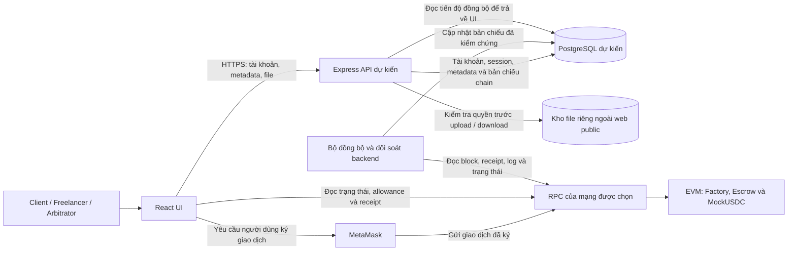
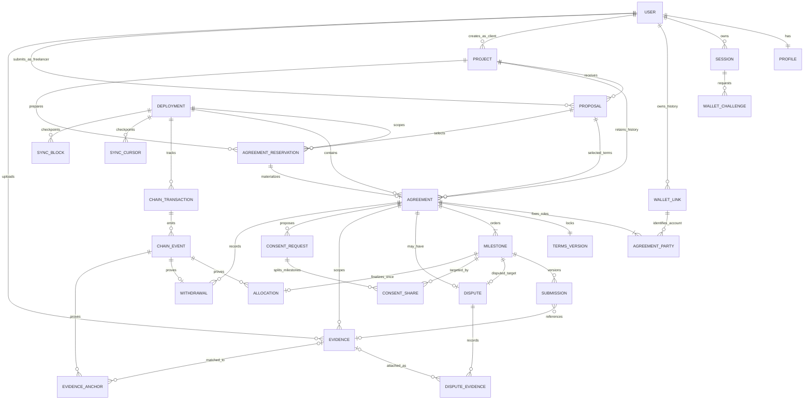
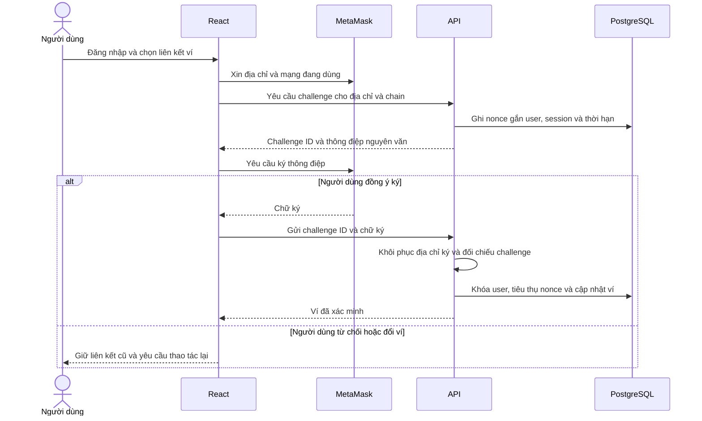
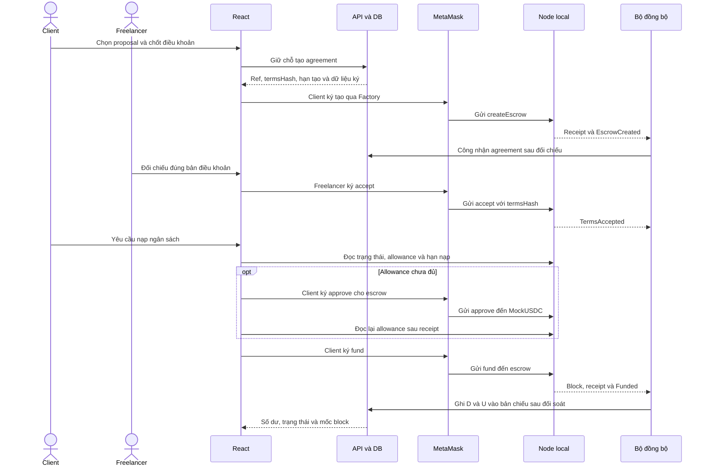
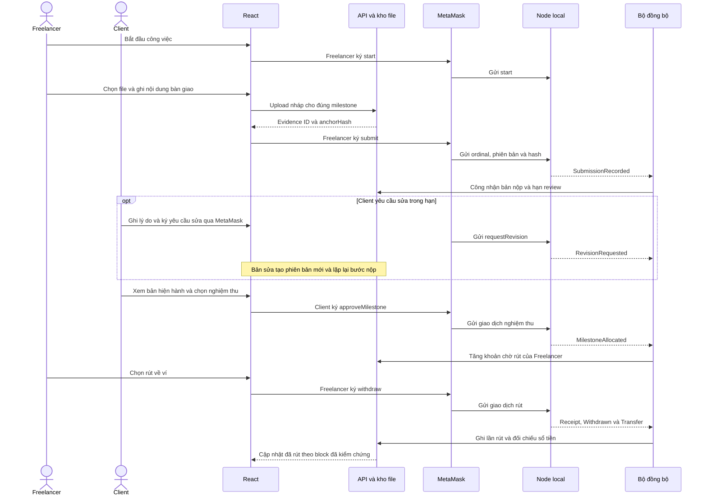
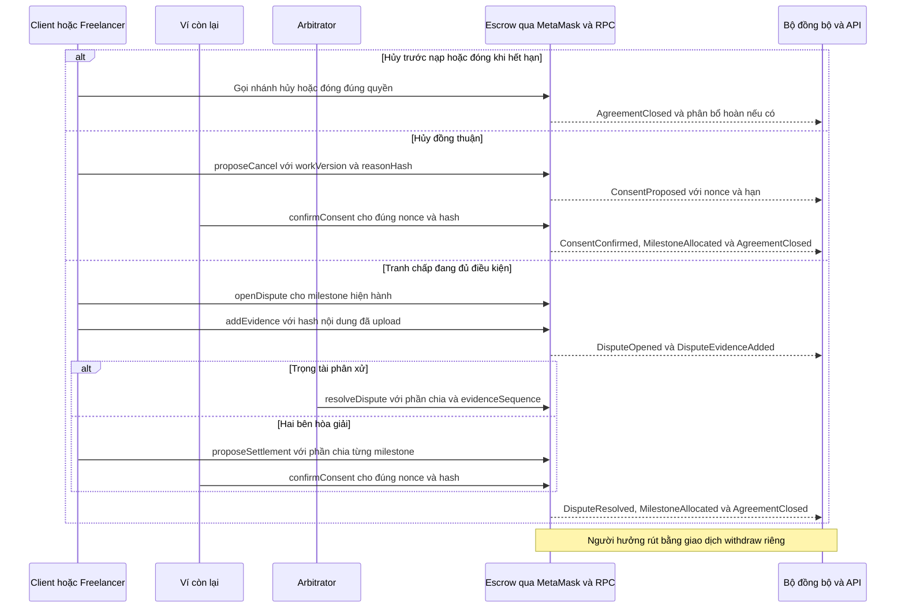

# Giai đoạn 4 — Kiến trúc chi tiết, ERD và luồng giao dịch

**Bàn giao ngày 09/11/2026.** Giai đoạn 4 đã hoàn thành ở mức thiết kế. Kiến trúc, ERD, luồng giao dịch, giao diện dữ liệu, quy cách hash và đồng bộ bên dưới là đầu vào triển khai. Website hiện dùng Node.js và SQLite cho tài khoản và workspace mô phỏng.

**Đầu vào:** [Giai đoạn 3 — Trạng thái, quyền hạn và quy tắc tiền](03-state-machine-va-quy-tac-tien.md), đặc biệt mục 2, 6 và 8.3. Tên trạng thái và quyền trong tài liệu đó tiếp tục được giữ nguyên.

## 1. Sơ đồ thành phần



Hai đường đi cần phân biệt:

- **Tài khoản và dữ liệu ứng dụng:** React → Express → PostgreSQL. API quản lý session, hồ sơ, dự án, đề xuất, metadata và quyền tải file. Thành công ở đường này chỉ xác nhận dữ liệu ứng dụng đã được lưu.
- **Thao tác ghi lên chain:** React → MetaMask → RPC → EVM/Escrow; tạo escrow đi qua Factory, cấp allowance đi qua MockUSDC. Người dùng ký bằng ví của mình. Backend đọc và kiểm chứng kết quả để cập nhật bản chiếu; không ký giao dịch hoặc giữ private key của người dùng.

UI có thể đọc dữ liệu công khai từ RPC mà không cần ký. API và bộ đồng bộ có thể cùng chạy trong một backend ở MVP, nhưng xử lý request tài khoản không được tự ghi nhận thay đổi tiền thay cho dữ liệu chain.

### 1.1. Hiện trạng và kiến trúc đích

| Thành phần | Đang có trong repository | Đích thiết kế của Giai đoạn 4 |
| --- | --- | --- |
| Giao diện | React/Vite; demo có dữ liệu riêng trong localStorage | Giữ UI, bổ sung kết nối ví và trạng thái xác minh dữ liệu |
| API | API Node.js cho tài khoản và workspace mô phỏng | Express cho tài khoản, metadata, file và truy vấn bản chiếu |
| Database | SQLite mặc định, có bộ lưu trữ PostgreSQL hoặc MongoDB khi được cấu hình | PostgreSQL theo ERD ở mục 2. Dữ liệu MOCK có phạm vi riêng với bản chiếu blockchain |
| Ví và contract | Solidity có MockUSDC, EscrowFactory và Escrow. Script chạy kịch bản trên Hardhat local | MetaMask ký giao dịch qua website và dùng ABI đã biên dịch |
| File và đồng bộ | Chưa có kho bằng chứng riêng và bộ đồng bộ chain theo thiết kế này | Kho file riêng, kiểm soát quyền qua API và bộ đồng bộ có đối soát |

Đây là bản thiết kế, không phải thông báo đã chuyển database hoặc đã có giao dịch thật. Các giao dịch MOCK và mã `DEMO-*` hiện tại không phải receipt on-chain.

### 1.2. Trách nhiệm và quyền quyết định dữ liệu

| Thành phần | Trách nhiệm | Giới hạn |
| --- | --- | --- |
| React UI | Hiển thị dữ liệu, chuẩn bị thao tác, yêu cầu ký, theo dõi hash/receipt và độ mới dữ liệu | Không tự kết luận đã nạp, đã phân bổ hoặc đã nhận token chỉ vì API trả thành công |
| MetaMask | Giữ khóa và xin chữ ký cho đúng ví, mạng, địa chỉ đích | Đăng nhập web không thay thế chữ ký ví; chữ ký không bảo đảm giao dịch thành công |
| Express API | Xác thực session, xác minh liên kết ví, kiểm tra quyền tài nguyên, lưu metadata và file | Role trong database không cấp quyền phân xử hoặc rút tiền trong contract |
| PostgreSQL | Lưu tài khoản, dữ liệu riêng và bản chiếu phục vụ truy vấn | Bản chiếu không quyết định số dư, quyền rút hoặc trạng thái tài chính |
| EVM/contracts | Kiểm tra địa chỉ gọi, trạng thái, deadline và sổ tiền theo Giai đoạn 3 | Không giữ nội dung file riêng; hash không chứng minh chất lượng bàn giao |
| Bộ đồng bộ | Kiểm chứng receipt/log đúng deployment, cập nhật bản chiếu và theo dõi tiến độ đồng bộ | Hash do UI gửi chỉ là đầu mối tra cứu, không phải bằng chứng thành công |

### 1.3. Nơi lưu file và ai được đọc

**Quyết định thiết kế:** file bàn giao và bằng chứng nằm trong kho riêng do backend quản lý, ngoài thư mục public của website. PostgreSQL chỉ lưu metadata như chủ sở hữu, liên kết agreement/milestone/dispute, phiên bản, mã đối tượng lưu trữ và hash. Chain chỉ lưu hash/tham chiếu cần thiết; không lưu nội dung riêng, URL có quyền truy cập hoặc thông tin đăng nhập.

| Dữ liệu | Ai được đọc qua ứng dụng |
| --- | --- |
| Hồ sơ tài khoản, session và challenge liên kết ví | Chính tài khoản; session/challenge chỉ được trả các trường cần cho luồng xác thực, không công khai |
| Nháp file chưa công bố | Chủ sở hữu nháp; chưa tự cấp quyền cho đối tác chỉ vì đã upload |
| File bàn giao đã công bố cho agreement | Client và Freelancer của agreement |
| Bằng chứng riêng của dispute, gồm file bàn giao được liên kết vào vụ | Hai bên và Arbitrator cố định của vụ đó, trong phạm vi vụ việc |
| Trạng thái, hash và event trên chain | Công khai với người có quyền truy cập mạng; không suy ra quyền tải file riêng |

API kiểm tra session và quan hệ với tài nguyên ở mỗi lần tải file. Biết mã file, hash hoặc địa chỉ escrow không đủ quyền đọc. Liên kết ví lịch sử cho phép tài khoản tiếp tục truy cập agreement cũ theo quy tắc Giai đoạn 3; đổi ví không đổi các bên đã khóa trong escrow.

Upload tạo một phiên bản bất biến. Muốn sửa nội dung phải tạo phiên bản mới, giữ bản cũ. Upload xong nhưng chưa có giao dịch bàn giao hợp lệ vẫn là nháp, chưa tạo `Submitted` hoặc mở hạn review. Không truy cập được file hoặc hash không khớp thì UI hiển thị chưa kiểm chứng. Quy cách hash và lưu trữ ở mục 7.4.

### 1.4. Ranh giới đối soát tối thiểu

1. UI nhận hash giao dịch và hiển thị trạng thái theo dõi tương ứng trong Giai đoạn 3; không tự tăng số dư hay chuyển trạng thái agreement.
2. Backend kiểm tra đúng deployment/chain, receipt, địa chỉ phát log và nội dung event; đợi số xác nhận theo cấu hình rồi mới ghi bản chiếu được công nhận.
3. Phản hồi truy vấn bản chiếu cần kèm mốc block, thời điểm đồng bộ và tình trạng xác minh để UI nhận biết dữ liệu cũ hoặc chưa đối soát. Khi RPC lỗi, giữ trạng thái chưa xác minh; không suy ra thất bại và tự gửi lại.
4. Cấp allowance qua `approve` chưa phải `fund`. Nghiệm thu chỉ phân bổ quyền rút; `withdraw` thành công mới chuyển token về ví. Agreement `Closed` vẫn có thể còn khoản chờ rút.

Định danh deployment và khôi phục đồng bộ ở mục 7. Giao diện dữ liệu ở mục 5.

## 2. ERD và lược đồ quan hệ

Đây là thiết kế đích cho PostgreSQL, chưa phải migration có thể chạy. `PK` là khóa chính, `FK` là khóa ngoại, `UQ` là ràng buộc duy nhất. Các bảng nghiệp vụ dùng `id` kiểu UUID làm PK nếu không nêu khác. Trường kết thúc bằng `_id` trong bảng bên dưới là FK tới đối tượng cùng tên; các ngoại lệ được ghi rõ. Dữ liệu riêng chỉ được đọc theo quyền mục 1.3.

### 2.1. Sơ đồ quan hệ



Sơ đồ thể hiện quan hệ chính. Các FK bổ sung và điều kiện nhiều bảng được mô tả dưới đây; ký hiệu một-nhiều không thay thế các kiểm tra vai trò hoặc tổng tiền.

### 2.2. Tài khoản, hồ sơ và liên kết ví

| Bảng | Trường chính và ràng buộc | Tính riêng tư |
| --- | --- | --- |
| `User` | `id`, `email_normalized UQ`, `password_hash`, `role`, `created_at`; role thuộc Client/Freelancer/Arbitrator | Email, hash mật khẩu không công khai; không trả hash qua API |
| `Profile` | `user_id PK/FK User`, `display_name`, `bio`, `updated_at`; tạo cùng User | Chỉ công bố các trường hồ sơ được phép |
| `Session` | `id`, `user_id`, `token_hash UQ`, `expires_at`, `revoked_at` | Không lưu token phiên dạng rõ trong DB |
| `WalletLink` | `id`, `user_id`, `address UQ`, `verified_at`, `deactivated_at`; địa chỉ 20 byte; tối đa một dòng có `deactivated_at IS NULL` cho mỗi user | Giữ lịch sử chủ tài khoản; địa chỉ đã dùng không chuyển cho tài khoản khác |
| `WalletChallenge` | `id`, `user_id`, `session_id`, `address`, `chain_id`, `domain`, `nonce UQ`, `issued_at`, `expires_at`, `consumed_at`; hạn 5 phút | Nonce dùng một lần, gắn đúng user/session; không lưu private key |

Ví cũ được kích hoạt lại bằng xác minh mới và cập nhật dòng WalletLink thuộc cùng tài khoản; không tạo chủ sở hữu mới. Việc tiêu thụ challenge, vô hiệu liên kết đang dùng và kích hoạt liên kết mới phải nguyên tử. Kiểm tra đổi ví phải bao gồm vai trò Arbitrator, agreement chưa nạp nhưng còn mở và khoản chờ rút ở mọi agreement cũ.

### 2.3. Dự án, agreement và milestone

| Bảng | Trường chính và ràng buộc | Vai trò dữ liệu |
| --- | --- | --- |
| `Project` | `id`, `project_ref UQ`, `client_user_id FK User`, `title`, `description`, `created_at` | Metadata dự án và tham chiếu ngẫu nhiên gửi lên chain. Không là sổ tiền |
| `Proposal` | `id`, `project_id`, `freelancer_user_id FK User`, `description`, `created_at`; `UQ(project_id, freelancer_user_id)` trong MVP | Một đề xuất/tài khoản/dự án; có thể sửa trước khi khóa điều khoản |
| `Deployment` | `id`, `chain_id`, `genesis_hash`, `instance_key UQ`, `factory_address`, `token_address`, `factory_creation_tx_hash`, `start_block`, `start_block_hash`, `abi_version`, hai hash mã runtime, `required_confirmations`, `retired_at` | Một lần triển khai; `instance_key` mới được ghi bất biến trong factory khi deploy |
| `AgreementReservation` | `id`, `project_id`, `proposal_id`, `deployment_id`, ba FK tới `WalletLink`, `project_ref`, `agreement_ref`, `create_by`, snapshot điều khoản và `terms_hash`, `status`; `UQ(deployment_id, agreement_ref)` | Giữ chỗ cho một lần chuẩn bị tạo. Trạng thái `Reserved`, `Linked`, `Expired`, `Retired`. Mỗi project có tối đa một dòng `Reserved` |
| `Agreement` | `id`, `reservation_id FK AgreementReservation UQ`, `project_id`, `proposal_id`, `deployment_id`, `escrow_address`, `canonical`, `status`, `close_reason`, `budget_units`, `work_version`, `fund_deadline`, `start_deadline`, `first_cancel_expires_at`, `cancel_work_version`; `UQ(deployment_id, escrow_address)` cho dòng canonical | Bản chiếu đã kiểm chứng của escrow chính thức; chỉ liên kết sau khi đối chiếu chain |
| `AgreementParty` | PK ghép `(agreement_id, party_role)`, `wallet_link_id`; `party_role` thuộc Client/Freelancer/Arbitrator; `UQ(agreement_id, wallet_link_id)` | Đúng ba bên khác nhau, cố định; tài khoản truy cập lịch sử qua WalletLink |
| `TermsVersion` | `id`, `agreement_id UQ`, `version`, `policy_version`, `terms_hash`, `immutable_document_key`, `created_at` | Snapshot điều khoản bất biến; MVP mỗi agreement khóa đúng một bản, thay điều khoản phải tạo agreement mới |
| `Milestone` | `id`, `agreement_id`, `ordinal`, `amount_units`, `base_due`, `activated_at`, `submit_by`, `review_by`, `revision_by`, `status`, `outcome`, `revision_count`; `UQ(agreement_id, ordinal)` | Thứ tự 0–9; trạng thái/kết quả theo Giai đoạn 3; bản chiếu deadline thực tế |
| `Submission` | `id`, `milestone_id`, `version`, `anchor_hash`, `evidence_id` tùy chọn, `submitted_at`, `source_event_id FK ChainEvent`; `UQ(milestone_id, version)` | Bản nộp on-chain đã xác minh, phiên bản 1–3. Có thể chưa tìm được nội dung off-chain cho hash |

`Agreement.status` dùng `AwaitingAcceptance`, `AwaitingFunding`, `Funded`, `Active`, `Disputed`, `Closed`. `Milestone.status/outcome` giữ đúng bảng Giai đoạn 3; không dùng `Paid` để thay cho phân bổ/rút. Không có dòng Dispute tương ứng trạng thái `None`.

Áp dụng chỉ mục duy nhất có điều kiện trên `Agreement(project_id)` khi `canonical` và `status <> 'Closed'`. Khóa dòng Project khi giữ chỗ và khi công nhận agreement. Kiểm tra proposal thuộc đúng project và Freelancer được chọn, Client là chủ project, các ví khớp liên kết đã xác minh. Dùng FK ghép `(proposal_id, project_id)` tới cặp duy nhất tương ứng trong Proposal để chặn ghép nhầm dự án.

Các ràng buộc tổng hợp phải được kiểm tra trong cùng transaction DB bằng service và constraint trigger trì hoãn khi triển khai: đúng ba vai trò, 1–10 milestone liên tục, tổng milestone bằng ngân sách, hạn cơ sở tăng dần và hạn đầu sau `start_deadline`. CHECK trên một dòng không đủ bảo đảm các điều kiện này. Đăng ký agreement và đổi ví phải khóa các dòng User liên quan theo thứ tự ID ổn định để tránh cạnh tranh; chưa đối soát được chain hoặc còn đăng ký chờ thì chặn đổi ví.

### 2.4. File, dispute và đề nghị đồng thuận

| Bảng | Trường chính và ràng buộc | Vai trò dữ liệu |
| --- | --- | --- |
| `Evidence` | `id`, `owner_user_id FK User`, `agreement_id`, `milestone_id` hoặc `dispute_id` tùy chọn, `purpose`, `version`, `previous_evidence_id FK Evidence` tùy chọn, `storage_key UQ`, `content_hash` nếu có file, `note_hash`, `anchor_hash`, `mime_type`, `size_bytes`, `created_at` | Nội dung riêng bất biến; nháp vẫn giữ trong bảng này |
| `Dispute` | `id`, `agreement_id UQ`, `milestone_id`, `opened_by_wallet_link_id FK WalletLink`, `reason_hash`, `status`, `latest_evidence_sequence`, `opened_event_id FK ChainEvent`, `resolved_event_id FK ChainEvent` tùy chọn | Tối đa một vụ/agreement, target là milestone thuộc agreement; trạng thái Open/ResolvedByArbitrator/SettledByParties |
| `DisputeEvidence` | `id`, `dispute_id`, `anchor_hash`, `evidence_id` tùy chọn, `sequence`, `source_event_id FK ChainEvent`; `UQ(dispute_id, sequence)` | Bằng chứng bổ sung đã neo; sequence bắt đầu 1, lý do mở vụ lưu riêng |
| `EvidenceAnchor` | `id`, `source_event_id FK ChainEvent`, `kind`, `agreement_id`, `milestone_id` hoặc `dispute_id` tùy chọn, `anchor_hash`, `evidence_id` tùy chọn; `UQ(source_event_id, kind)` | Liên kết nội dung lý do yêu cầu sửa, mở vụ, đề nghị đồng thuận hoặc phán quyết với event đã xác minh |
| `ConsentRequest` | `id`, `agreement_id`, `kind`, `nonce`, `work_version`, `state_hash`, `payload_hash`, `consent_hash`, `proposer_wallet_link_id FK WalletLink`, `expires_at`, `proposed_event_id FK ChainEvent`, `confirmed_event_id FK ChainEvent` tùy chọn; `UQ(agreement_id, nonce)` | `kind` là Cancel/Settlement; giữ mọi đề nghị, kể cả đã hết hạn hoặc vô hiệu |
| `ConsentShare` | PK ghép `(consent_request_id, milestone_id)`, `client_units`, `freelancer_units` | Chi tiết chia từng milestone của hòa giải; hủy chỉ hoàn toàn bộ U cho Client |

Evidence được chia sẻ qua Submission, DisputeEvidence hoặc EvidenceAnchor đã được công nhận. Hai bên được đọc lý do hoặc quyết định liên quan đến agreement của mình. Arbitrator chỉ đọc trong phạm vi vụ được giao. Upload đơn thuần không cấp quyền cho đối tác. Một file bàn giao cũ có thể được liên kết làm bằng chứng trong vụ. Dùng FK ghép hoặc trigger để bảo đảm milestone, file, dispute và đề nghị thuộc cùng agreement. `previous_evidence_id` phải cùng chủ sở hữu và phạm vi, không tạo chu trình.

Phần chia hòa giải phải phủ đúng các milestone chưa phân bổ, mỗi cặp không âm và cộng bằng giá trị milestone; không chạm phần đã phân bổ. Nonce, work version, người xác nhận khác người đề nghị và hạn hiệu lực phải đối chiếu chain. Không lưu một cờ `accepted=true` thay cho bằng chứng hai giao dịch. `first_cancel_expires_at` gắn với `cancel_work_version` giữ mốc bế tắc đầu tiên; đề nghị thay thế không đẩy lùi mốc này.

### 2.5. Transaction, event, sổ phân bổ và con trỏ đồng bộ

| Bảng | Trường chính và ràng buộc | Vai trò dữ liệu |
| --- | --- | --- |
| `ChainTransaction` | `id`, `deployment_id`, `agreement_id` hoặc `reservation_id` tùy chọn, `initiated_by_user_id FK User` tùy chọn, `operation`, `tx_hash` tùy chọn, `sender_address`, `sender_nonce` tùy chọn, `target_address`, `call_data_hash` tùy chọn, `status`, `block_number`, `block_hash`, `receipt_status`, `error_code`, `replacement_id FK ChainTransaction` tùy chọn; `UQ(deployment_id, tx_hash)` khi có hash | Trạng thái AwaitingSignature/Rejected/Broadcast/Mined/Confirmed/Reverted/Unknown; approve nhắm token, create nhắm factory, các thao tác còn lại nhắm escrow |
| `ChainEvent` | `id`, `deployment_id`, `transaction_id FK ChainTransaction`, `tx_hash`, `log_index`, `emitter_address`, `block_number`, `block_hash`, `event_name`, `decoded_payload`, `canonical`; `UQ(deployment_id, tx_hash, log_index, block_hash)` | Giữ các lần xuất hiện log theo nhánh block; chỉ một bản canonical cho `(deployment_id, tx_hash, log_index)` bằng chỉ mục duy nhất có điều kiện |
| `Allocation` | `id`, `milestone_id UQ`, `client_units`, `freelancer_units`, `reason`, `source_event_id FK ChainEvent` | Một phân bổ cuối/milestone; tổng hai phần bằng giá trị milestone; trước nạp Voided không tạo phân bổ |
| `Withdrawal` | `id`, `agreement_id`, `recipient_wallet_link_id FK WalletLink`, `amount_units`, `source_event_id FK ChainEvent UQ` | Một lần rút đã kiểm chứng; người hưởng chỉ là Client/Freelancer cố định, không suy ra từ Allocation rằng tiền đã về ví |
| `SyncCursor` | PK ghép `(deployment_id, stream_key)`, `block_number`, `block_hash`, `updated_at` | Checkpoint ở cuối block đã xử lý, tiến cùng transaction cập nhật bản chiếu |
| `SyncBlock` | PK ghép `(deployment_id, block_number, block_hash)`, `parent_hash`, `canonical`; chỉ một hash canonical mỗi độ cao | Lưu cả block trống để tìm tổ tiên chung khi reorg |

Transaction chưa có hash vẫn có ID nội bộ để theo dõi yêu cầu ký. Giao dịch phát hiện từ chain mà UI chưa báo vẫn được index. `initiated_by_user_id` có thể rỗng. AwaitingSignature và Rejected giữ hash rỗng. Quy tắc thử lại và giao dịch thay thế ở mục 6.

FK ghép phải giữ `ChainEvent.deployment_id/tx_hash` khớp ChainTransaction; các quan hệ tới source event phải cùng deployment/agreement và đúng địa chỉ phát log. Không áp dụng UQ thuần chain ID/hash vì reset local có thể tái sử dụng chúng. `instance_key` là ranh giới dữ liệu của một lần chạy được quản lý, cần kiểm tra thêm fingerprint block/contract; genesis hash riêng lẻ không đủ phát hiện mọi reset.

Event thô giữ lịch sử canonical/orphaned. Allocation, Withdrawal, Submission và các trường trạng thái là bản chiếu của nhánh được công nhận: khi reorg phải hoàn tác/xây lại trước khi công bố snapshot mới; không cộng cả hai nhánh. Lưu mốc block/hash và thời điểm xác minh của snapshot agreement để UI đánh giá độ mới. Thuật toán quét bù, rollback và reset chi tiết thuộc mục 7, chưa được triển khai ở đây.

### 2.6. Kiểu dữ liệu và quy tắc toàn vẹn

- Địa chỉ lưu dạng 20 byte; hash giao dịch/block/nội dung dạng 32 byte với kiểm tra độ dài, không so sánh bằng chuỗi khác hoa thường. Quy cách tạo content/terms hash sẽ chốt ở mục 7.
- Tiền dùng số nguyên `numeric(78,0)`, kiểm tra từ 0 tới `2^256 - 1`; ngân sách và amount milestone phải lớn hơn 0. MockUSDC có 6 decimals. API trao đổi số tiền bằng chuỗi thập phân nguyên để tránh mất chính xác khi chuyển qua JavaScript Number.
- Chain ID, block number, nonce, work version và thời gian Unix của chain dùng số nguyên có kiểm tra miền phù hợp; không dùng số thực. Thời gian tài khoản/session dùng `timestamptz`. Deadline nghiệp vụ lấy từ chain, không lấy đồng hồ máy chủ làm nguồn quyết định.
- FK lịch sử dùng RESTRICT khi xóa; đóng agreement, thu hồi session và vô hiệu ví bằng trạng thái/thời điểm, không xóa dây chuyền lịch sử tài chính. Chính sách lưu/xóa file riêng sẽ chốt riêng.
- Bản chiếu kiểm tra `D = U + Cf + Cc + Wf + Wc`, `Closed ⇒ U = 0`; tổng phân bổ/rút phải khớp chain. D lấy từ nạp hợp lệ, không từ tổng token chuyển trực tiếp vào escrow. Nếu đối soát lệch thì đánh dấu chưa xác minh, không sửa chain bằng dữ liệu DB.

### 2.7. Các tình huống rà soát thiết kế

| Tình huống | Kết quả yêu cầu của lược đồ và service |
| --- | --- |
| Hai tài khoản cùng xác minh một ví; một tài khoản mở hai ví hoạt động | UQ địa chỉ và chỉ mục một ví hoạt động chặn; challenge tiêu thụ nguyên tử |
| Đổi ví đồng thời đăng ký agreement hoặc còn vai trò Arbitrator | Khóa User và kiểm tra chain đã đối soát; không bỏ lọt agreement mở/khoản chờ rút |
| Hai agreement đang mở cho một project | Chỉ mục có điều kiện và khóa Project chặn; agreement Closed cũ được giữ |
| Dispute hoặc file của milestone khác agreement | FK ghép/trigger chặn, không chỉ kiểm tra từng ID tồn tại |
| Upload thành công rồi từ chối ký | Evidence vẫn là nháp; không có Submission được công nhận |
| Index lại cùng log; một event đóng phân bổ nhiều milestone | Log không nhân đôi; nhiều Allocation cùng source event được phép nhưng mỗi milestone chỉ một Allocation |
| Reorg hoặc reset tái dùng chain ID/hash/địa chỉ | Tách lần triển khai; giữ nhánh log và xây lại bản chiếu canonical |
| Nghiệm thu 30 rồi rút 30 trong ngân sách 100 | Allocation ghi 30, Withdrawal ghi 30; U=70, Cf=0, Wf=30; không cộng thành đã nhận 60 |

Các dòng trên là ca rà soát thiết kế, chưa phải kiểm thử database đã chạy. **Tiêu chí đạt mục 2:** truy được project → proposal → agreement → milestone → evidence/dispute và event nguồn, có lịch sử ví, điều khoản, đồng thuận, phân bổ/rút và checkpoint; xác định được ràng buộc nào ở DB, ràng buộc nào cần transaction/service và kiểm chứng chain.

## 3. Nguồn dữ liệu và cách hiển thị

| Dữ liệu | Nguồn quyết định | Kiểm tra và hiển thị |
| --- | --- | --- |
| User, Profile, vai trò web, session, địa chỉ ví đã liên kết | PostgreSQL và kết quả kiểm tra chữ ký của API | UI lấy từ session. Hiển thị ví đã xác minh và ví đang mở trong MetaMask thành hai trường riêng. |
| Project, Proposal, nội dung điều khoản | PostgreSQL và bản nội dung bất biến | Bản nháp được sửa trước giữ chỗ. Sau tạo escrow, đối chiếu điều khoản với `termsHash` đã khóa. |
| Deployment, ví của ba bên, token, ngân sách, thứ tự và hạn cơ sở | Factory và escrow trên deployment đã nhận diện | So khớp với bản giữ chỗ khi công nhận agreement. Metadata khác với chain thì đánh dấu lệch và chặn tạo yêu cầu tài chính từ màn hình đó. |
| Trạng thái agreement/milestone, deadline hiệu lực, đề nghị, nonce, dispute và số thứ tự bằng chứng | Trạng thái và event escrow tại block chuẩn | Hiển thị bản chiếu theo block đã đối soát. UI đọc lại RPC trước khi ký để phát hiện trạng thái hoặc phiên bản đã đổi. |
| Số dư MockUSDC và allowance | `balanceOf` và `allowance` của token đúng deployment | Đọc tại block gắn với số liệu đang đối chiếu. Allowance hiển thị riêng với khoản đã nạp. |
| `D, U, Cf, Cc, Wf, Wc` và lịch sử phân bổ/rút | Sổ escrow và event canonical. PostgreSQL lưu bản chiếu để truy vấn | Tách đã nạp, chưa phân bổ, chờ rút, đã rút. Phần dư do chuyển token trực tiếp là chênh lệch số dư ngoài sổ. |
| File, nội dung bằng chứng và quyền tải | Kho file riêng, dữ liệu PostgreSQL và quyền theo mục 1.3 | So hash với lần neo on-chain. Nếu thiếu file, sai hash hoặc chưa có quyền, hiển thị trạng thái tương ứng. |
| Đang chờ ký hoặc từ chối ký | Phản hồi ví | Có ID theo dõi nội bộ. Hash giao dịch chỉ xuất hiện khi có giá trị thực. |
| Đã gửi, vào block, revert, xác nhận | Transaction, receipt và block chuẩn từ RPC | Hiển thị hash thật, số xác nhận, mốc block và trạng thái đối soát. Lỗi RPC giữ kết quả chưa rõ. |

API trả mỗi snapshot kèm `deploymentId`, `asOfBlock`, `blockHash`, `verifiedAt` và `verification` với giá trị `verified`, `syncing` hoặc `unverified`. Khi dữ liệu bị trễ, UI ghi rõ mốc đã kiểm chứng gần nhất. Nếu đang khôi phục reorg hoặc nghi ngờ reset, không trình bày số liệu cũ như hiện hành. UI có thể báo “receipt đã xác nhận, đang cập nhật dashboard” khi bộ đồng bộ chưa xử lý tới block đó.

## 4. Luồng tuần tự

### 4.1. Xác minh và đổi ví



Dùng định dạng thông điệp ERC-4361 trong session email hiện có, với mục đích cố định `Link wallet to Freelancer Escrow`. API tạo thông điệp nguyên văn từ origin cấu hình, URI của ứng dụng, địa chỉ, chain ID local, nonce ngẫu nhiên, thời điểm cấp và hạn 5 phút. Nonce dùng 16 byte ngẫu nhiên mã hóa hex không có tiền tố. Lưu thông điệp hoặc đủ trường để tái tạo byte giống hệt. API chỉ nhận `challengeId` và chữ ký, kiểm tra EOA, đúng mục đích, domain/URI, chain, địa chỉ, user/session và hạn. Chữ ký thông điệp không tạo transaction. Tham khảo [ERC-4361](https://eips.ethereum.org/EIPS/eip-4361).

Đổi ví và giữ chỗ tạo agreement dùng cùng khóa theo thứ tự ở mục 2.3. Trong lần cập nhật nguyên tử, kiểm tra lại nonce, quyền sở hữu ví, các agreement và bản giữ chỗ của ví cũ. Đọc trạng thái chính thức theo block đã xác nhận và chỉ đổi khi bản chiếu đã bắt kịp mốc đó, deployment đang xác minh được, mọi agreement liên quan đã đóng và quyền rút của ví cũ bằng 0. Nếu thiếu dữ liệu thì chặn đổi. Sự kiện `accountsChanged`, `chainChanged` hoặc `disconnect` xóa dữ liệu chuẩn bị ký trên UI và buộc đối chiếu lại ví, mạng và deployment. Tham khảo [EIP-1193](https://eips.ethereum.org/EIPS/eip-1193).

### 4.2. Tạo agreement, chấp nhận và ký quỹ



API giữ chỗ dưới khóa Project và các User liên quan, chụp ba địa chỉ đã xác minh, deployment, proposal và bản điều khoản bất biến. `projectRef` là 32 byte ngẫu nhiên cố định cho project, `agreementRef` là 32 byte ngẫu nhiên mới cho mỗi lần giữ chỗ. `createBy` mặc định bằng timestamp block chuẩn mới nhất cộng 30 phút. Đây là hạn gửi tạo escrow. Các hạn nạp/start vẫn tính từ thời điểm tạo theo Giai đoạn 3. Factory kiểm tra hạn tại thời điểm thực thi và chỉ tạo một lần cho cặp `(client, agreementRef)`.

Chỉ công nhận receipt tạo từ đúng Client tới factory, có event khớp `projectRef`, `agreementRef`, `termsHash` và đúng cấu hình escrow. Worker có thể tự tìm event khi UI đóng trước khi gửi hash cho API. Nếu người dùng bỏ giữa chừng, chỉ hết giữ chỗ sau khi đã quét hết các block đủ xác nhận có timestamp trong hạn tạo và thấy mốc sau `createBy` mà không có tạo hợp lệ. Hết giờ trên đồng hồ trình duyệt hoặc hash bị mất chưa đủ để bỏ giữ chỗ. Giao dịch tạo từ ngoài ứng dụng vẫn có thể tồn tại trên chain. Chỉ escrow khớp bản giữ chỗ mới được đưa vào project.

Freelancer kiểm tra nội dung và hash đã khóa trước khi ký. Client chỉ gửi `fund` sau khi đọc lại đủ allowance, trạng thái `AwaitingFunding` và hạn. Nếu allowance đã đủ, bỏ qua bước approve. Trong luồng UI, lần cấp mới đặt đúng ngân sách. Khi sửa allowance đang dương và chưa đủ, đặt về 0, xác nhận và đọc lại rồi mới cấp số mới. Số tiền nhận thực do contract đo khi fund. Receipt approve chỉ xác nhận thao tác với token, không tăng `D`.

### 4.3. Bàn giao, nghiệm thu và rút



Upload lỗi thì chưa có hash để ký. Từ chối ký hoặc revert giữ nháp. Nếu có bản nộp on-chain đúng quyền nhưng thiếu nội dung tương ứng, vẫn cập nhật trạng thái chain và báo file chưa kiểm chứng. Với lịch sử bản sửa, backend luôn ghi bản mới thay vì ghi đè. Nghiệm thu lấy đúng ordinal, phiên bản công việc và bản nộp. Rút chuyển toàn bộ quyền hiện có của ví gọi về chính ví đó. Client rút hoàn bằng cùng thao tác `withdraw`.

### 4.4. Hủy và tranh chấp



Mỗi thao tác ghi trong sơ đồ là giao dịch do ví đúng quyền ký. `cancelBeforeFunding`, `expireFunding` và `expireStart` có quyền khác nhau theo Giai đoạn 3. Khi có dispute, việc rút khoản cũ vẫn tiếp tục. Chỉ thao tác phân xử hoặc xác nhận hòa giải hợp lệ đầu tiên đóng vụ. Một đề nghị hết hạn, sai phiên bản hoặc dùng lại nonce phải revert, kể cả khi UI chưa cập nhật nút.

## 5. Giao diện dữ liệu giữa UI, API và contract

### 5.1. API dự kiến

Các đường dẫn dưới đây thuộc API chính thức sẽ triển khai. Mã ID trong HTTP là UUID của ứng dụng. Chuỗi hex mang địa chỉ 20 byte hoặc hash/ref 32 byte. Số tiền, nonce, chain ID và block number trên JSON dùng chuỗi thập phân nguyên. API chỉ xác nhận đã lưu yêu cầu, hash hoặc bản chiếu có bằng chứng.

| API | Nhận | Trả và điều kiện |
| --- | --- | --- |
| `POST /api/wallet/challenges` | `address, chainId` | `challengeId, message, expiresAt`. Session hợp lệ và đúng deployment. |
| `POST /api/wallet/verify` | `challengeId, signature` | `walletLinkId, address, verifiedAt`. Kiểm tra mục 4.1. |
| `GET /api/deployments/current` | Session nếu truy cập workspace | `deploymentId, instanceKey, chainId, factory, token, abiVersion, requiredConfirmations`, mốc triển khai và các hash để kiểm tra fingerprint theo mục 7.1. |
| `POST /api/projects/:projectId/agreement-reservations` | `proposalId, arbitratorUserId, termsText, budgetUnits, milestones[]` gồm `amountUnits, baseDue` theo thứ tự | Bản giữ chỗ, hash, ba ví đã chụp và hạn tạo. Client sở hữu project. Proposal và trọng tài phải đủ điều kiện. |
| `GET /api/agreements/:agreementId` | Session và ID | Snapshot, điều khoản, milestone, deadline, vai trò, sổ tiền, lịch sử và mốc đối soát. API lọc file, nội dung riêng và lịch sử theo quyền. |
| `POST /api/agreements/:agreementId/evidence` | Tệp tùy chọn, ghi chú, mục đích, `milestoneId` hoặc `disputeId` theo phạm vi | `evidenceId, contentHash, noteHash, anchorHash, status=draft`. Kiểm tra quyền và giới hạn trước khi lưu. |
| `GET /api/evidence/:evidenceId/content` | Session và ID | Nội dung được phép hoặc lỗi quyền. Dùng để tải và kiểm tra hash. |
| `POST /api/chain-transactions` | `deploymentId, operation`, ID agreement hoặc reservation, tham số thao tác | ID theo dõi, `from, to, data, chainId` và các điều kiện đã đọc. Chỉ chuẩn bị dữ liệu để ký. |
| `PATCH /api/chain-transactions/:id` | `txHash` hoặc tín hiệu `Rejected` từ ví, và hash thay thế nếu ví cung cấp | Trạng thái theo dõi. API tra lại RPC và gộp theo khóa duy nhất nếu worker đã thấy hash trước. |
| `GET /api/chain-transactions/:id` | Session và ID | Trạng thái, hash nếu có, receipt status, block, số xác nhận, thông tin thay thế và kết quả đối soát. |

Lỗi chuẩn trả `code, message`. Dùng `401` cho thiếu session, `403` cho sai vai trò hoặc phạm vi, `409` cho phiên bản cũ, giữ chỗ cạnh tranh, nonce đã dùng, ví trùng hoặc trạng thái sai, `422` cho điều khoản/tham số không hợp lệ, `413` cho vượt giới hạn upload và `503` khi RPC hoặc bộ đồng bộ chưa đủ dữ liệu xác minh. UI chỉ đề xuất thử lại sau khi đọc trạng thái mới. Các endpoint mô phỏng hiện có được giữ riêng khi triển khai bản chính thức.

### 5.2. Thao tác ghi và event dự kiến

Bảng ghi tên logic và dữ liệu tối thiểu. Thứ tự tham số, kiểu ABI và giá trị enum phải được khóa cùng `abiVersion` khi viết Solidity. Mọi tiền là số nguyên đơn vị nhỏ nhất. Các tham số kỳ vọng được contract so với trạng thái hiện hành. Contract vẫn tự kiểm tra quyền, deadline và số tiền theo Giai đoạn 3.

| Đích và thao tác | Tham số nghiệp vụ | Event và dữ liệu tối thiểu |
| --- | --- | --- |
| Factory `createEscrow` | `projectRef, agreementRef, createBy, freelancer, arbitrator, budgetUnits, amounts[], baseDues[], policyVersion, documentHash, termsHash` | `EscrowCreated(escrow, client, projectRef, agreementRef, termsHash)`. Đọc lại các điều khoản cố định từ escrow. |
| Escrow `accept` | `termsHash` kỳ vọng | `TermsAccepted(termsHash)` |
| MockUSDC `approve` | `spender=escrow, amount` | `Approval(owner, spender, amount)`. Đọc lại allowance. |
| Escrow `fund` | Gọi từ Client, dùng ngân sách bất biến | `Funded(client, amount)`, đối chiếu `Transfer` của token từ Client đến escrow. |
| Escrow `start` | Gọi từ Freelancer | `WorkStarted(ordinal, activatedAt, submitBy)` |
| Escrow `submit` | `ordinal, expectedWorkVersion, anchorHash` | `SubmissionRecorded(ordinal, submissionVersion, anchorHash, submittedAt, reviewBy)` |
| Escrow `requestRevision` | `ordinal, expectedWorkVersion, expectedSubmissionVersion, reasonHash` | `RevisionRequested(ordinal, submissionVersion, revisionCount, reasonHash, revisionBy)` |
| Escrow `approveMilestone` | `ordinal, expectedWorkVersion, expectedSubmissionVersion` | `MilestoneAllocated` cho mốc hiện hành. Nếu mở mốc kế, `MilestoneActivated(ordinal, activatedAt, submitBy)`. Nếu hết mốc, `AgreementClosed`. |
| Escrow `cancelBeforeFunding`, `expireFunding`, `expireStart` | Nhánh tương ứng, theo quyền và hạn | `AgreementClosed(reason)`, thêm `MilestoneAllocated` cho từng khoản hoàn nếu đã nạp. |
| Escrow `proposeCancel`, `proposeSettlement` | `expectedWorkVersion, reasonHash` và hai mảng phần chia nếu hòa giải | `ConsentProposed(kind, nonce, proposer, workVersion, expiresAt, reasonHash, stateHash, payloadHash, consentHash)`. Lấy danh sách phần chia từ calldata đã kiểm chứng. |
| Escrow `confirmConsent` | `nonce, consentHash` | `ConsentConfirmed(nonce, confirmer, consentHash)` và các event phân bổ, đóng agreement hoặc đóng dispute tương ứng. |
| Escrow `openDispute` | `ordinal, expectedWorkVersion, ground, reasonHash` | `DisputeOpened(ordinal, opener, ground, reasonHash)`. Một vụ trên một escrow nên ordinal xác định vụ trong phạm vi escrow. |
| Escrow `addEvidence` | `disputedOrdinal, anchorHash` | `DisputeEvidenceAdded(ordinal, sequence, author, anchorHash)` |
| Escrow `resolveDispute` | `disputedOrdinal, expectedEvidenceSequence, clientUnits, freelancerUnits, decisionHash` | `DisputeResolved(ordinal, method, evidenceSequence, decisionHash)`, `MilestoneAllocated` và `AgreementClosed`. Khi hòa giải, trường `decisionHash` là `consentHash` và nội dung lấy từ đề nghị đã được xác nhận. |
| Escrow `withdraw` | Không có địa chỉ đích hoặc số tiền tùy ý | `Withdrawn(recipient, amount)`, đối chiếu `Transfer` của đúng token từ escrow tới người hưởng. |

`MilestoneAllocated(ordinal, outcome, clientUnits, freelancerUnits)` ghi một event cho mỗi mốc hoàn tất. `AgreementClosed(reason)` phát khi sổ chưa phân bổ đã về 0. Giao dịch làm tăng phiên bản phát thêm `WorkVersionChanged(newVersion)` đúng một lần. Xử lý toàn bộ log của một transaction cùng nhau. Đọc snapshot tại cuối block để đối chiếu các trạng thái và deadline cuối cùng. Cần các hàm đọc cho cấu hình bất biến, trạng thái agreement, milestone hiện hành, từng milestone, đề nghị, dispute, số thứ tự bằng chứng và các số `D, U, Cf, Cc, Wf, Wc`.

### 5.3. Ánh xạ ID và chống ghép sai

| Khóa | Ánh xạ và điều kiện |
| --- | --- |
| `projectId` | Khóa nội bộ ↔ `projectRef` ngẫu nhiên của Project. Kiểm tra proposal thuộc đúng project. |
| `reservationId` | ↔ `(deploymentId, agreementRef)`. Factory trả đúng ref, ví Client và hash. |
| `agreementId` | ↔ `(deploymentId, escrowAddress)` canonical qua Reservation và event của đúng factory. |
| `milestoneId` | ↔ `(agreementId, ordinal)`. Chỉ số từ 0, không suy ra từ tên milestone. |
| `disputeId` | ↔ agreement và ordinal tranh chấp. `sequence` định danh từng lần bổ sung bằng chứng. |
| `evidenceId` | ↔ hash và phạm vi agreement/milestone/dispute cùng người ghi. Hash trùng ở nơi khác không tạo quyền tải. |
| `txId` nội bộ | ↔ `(deploymentId, txHash)` sau khi tìm được hash. Transaction thiếu hash chỉ là theo dõi yêu cầu ký. |

Trạng thái email/session chỉ quyết định quyền API. Ví đang mở, ví đã liên kết và địa chỉ có quyền trên escrow phải cùng khớp trước khi UI gửi thao tác. Nếu một giao dịch đúng quyền được thực hiện trực tiếp ngoài UI trên escrow chính thức, worker vẫn ghi nhận. Với log chưa có bản nháp file tương ứng, chỉ tạo liên kết nội dung sau khi kiểm tra hash, người gửi và phạm vi đã xác minh.

### 5.4. Ánh xạ sang ABI v1

Các tên ở mục 5.2 dùng cho thiết kế luồng. Khi ký hoặc giải mã log, lấy chữ ký chính xác từ ABI được sinh bởi Hardhat cho mã Solidity hiện tại. Manifest do `chain:deploy` tạo ghi `abiVersion=1` và fingerprint theo mục 7.1.

| Nghiệp vụ ở mục 5.2 | Hàm, event và nguồn trường của ABI v1 |
| --- | --- |
| Tạo, chấp nhận và nạp | Factory gọi `createEscrow(terms, expectedTermsHash)`, đọc `EscrowCreated`. Escrow phát `TermsAccepted(termsHash)` và `Funded(amount)`. Ví nạp lấy từ transaction sender và đối chiếu `client()`. |
| Bắt đầu, chuyển mốc, đóng và phiên bản | Dùng `StateChanged(state, closure, version)`. Xác định mốc kích hoạt từ thao tác và ordinal đã nghiệm thu. Thời điểm kích hoạt lấy từ block. Đối chiếu `current()` và deadline của milestone khi đọc snapshot. |
| Bàn giao và yêu cầu sửa | `Submitted(milestone, evidenceHash, reviewBy)` và `RevisionRequested(milestone, reasonHash, revisionBy)`. Đếm các bản nộp/yêu cầu sửa từ log canonical theo thứ tự. `approveMilestone` và `requestRevision` bảo vệ bản đang xem bằng ordinal và `expectedVersion`, vì lần nộp mới làm tăng work version. |
| Phân bổ và đóng trước nạp | `Allocated(milestone, outcome, toFreelancer, toClient)`. `cancelUnfunded()` phát `StateChanged` với lý do tương ứng. `expireFunding()` và `expireStart()` giữ đúng tên. |
| Đề nghị, xác nhận và hòa giải | `OfferMade(nonce, digest, author, settlement, expiresAt, reasonHash)` định danh đề nghị. `proposeSettlement` nhận mảng phần Freelancer. Phần Client bằng số tiền mốc trừ phần đó. Tính lại state/payload hash từ dữ liệu trước thao tác, calldata và mục 7.4. Xác nhận qua `confirmOffer(nonce, digest)`. Receipt thành công, calldata, ví gọi, các log `Allocated` và `StateChanged` cùng chứng minh thao tác đóng. Khi hòa giải, `StateChanged` có closure `Settled`. |
| Tranh chấp và phân xử | `DisputeOpened` và `EvidenceAdded(sequence, evidenceHash, author)`. Lấy ordinal bổ sung từ vụ đang mở. `resolve(toFreelancer, expectedEvidenceCount, decisionHash)` phát `Resolved(decisionHash, evidenceCount)`, `Allocated` và `StateChanged`. Phần Client của mốc tranh chấp bằng giá trị mốc trừ phần Freelancer. |
| Rút và số dư | `Withdrawn(beneficiary, amount)` và `Transfer` từ token. Đối chiếu với `funded()`, `unallocated()`, `claimable(address)`, `withdrawn(address)` và `balanceOf(escrow)`. |

## 6. Vòng đời giao dịch và xác nhận

| Trạng thái | Bằng chứng | Phản hồi UI |
| --- | --- | --- |
| `AwaitingSignature` | Yêu cầu gửi sang ví, chưa có hash | Chờ người dùng thao tác trong ví. |
| `Rejected` | Ví trả từ chối rõ ràng trước khi gửi và chưa có bằng chứng broadcast | Giữ thao tác nghiệp vụ ở trạng thái cũ. |
| `Broadcast` | Có hash từ ví hoặc thấy transaction trên RPC, chưa có receipt canonical | Hiển thị hash và chờ. |
| `Mined` | Receipt thành công và hash block khớp chain chuẩn, chưa đạt ngưỡng | Hiển thị số xác nhận hiện tại. |
| `Confirmed` | Receipt thành công trên nhánh chuẩn, đủ ngưỡng và dữ liệu phù hợp thao tác theo mục 7.2 | Hiện đã xác nhận. Hiện riêng đang chờ cập nhật dashboard nếu bản chiếu chưa tới block đó. |
| `Reverted` | Receipt lỗi trên nhánh đang được công nhận | Giữ nguyên nghiệp vụ từ giao dịch này, có thể phát sinh gas ETH local. |
| `Unknown` | RPC mất kết nối, receipt mất, ví không trả hash rõ ràng hoặc dữ liệu chưa đối chiếu được | Giữ hash nếu có. Tra lại, không tự gửi lại. |

Ngưỡng mặc định local là **1**. Nếu block chứa giao dịch còn canonical, số xác nhận là `head - receipt.blockNumber + 1`. Ngưỡng này phục vụ demo và vẫn có thể đảo do reorg/reset. Khi block đổi nhánh, hạ trạng thái đã ghi. Trở về `Broadcast` nếu RPC thấy hash đang chờ, `Unknown` nếu chưa rõ, hoặc đánh giá lại từ receipt mới. Trạng thái bản chiếu có thể chậm hơn trạng thái receipt.

Khi ví báo thay thế, xác minh bằng transaction/receipt thật trên đúng deployment, cùng người gửi và nonce. Nếu hash mới canonical và cùng đích/calldata thì theo dõi nó như lần thay phí của thao tác ban đầu. Nếu là giao dịch hủy/thao tác khác, đánh dấu lần cũ `Unknown` với mã `REPLACED`, lưu liên kết tới hash mới và giữ nghiệp vụ của thao tác cũ theo chain. Nonce đã tăng nhưng chưa có hash thay thế kiểm chứng được chỉ là tín hiệu cần tra thêm. Sau timeout hoặc tải lại trang, thử tra transaction và receipt bằng hash, kiểm tra lịch sử ví nếu mất hash. Người dùng chỉ thử lại sau khi đọc lại trạng thái, phiên bản và allowance. Nhánh tạo agreement còn chịu giới hạn Reservation ở mục 4.2.

## 7. Đồng bộ, đối soát và quy cách hash

### 7.1. Nhận diện deployment

Mỗi lần deploy local, script tạo một `instanceKey` ngẫu nhiên 32 byte, đưa vào constructor factory để đọc lại qua getter bất biến. Khi kích hoạt, ghi `chainId`, genesis hash, địa chỉ token/factory, hash mã runtime của hai địa chỉ, transaction triển khai factory, block/hash triển khai, ABI version và ngưỡng xác nhận. Kiểm tra receipt triển khai thành công và token mà factory trả về. Đối chiếu cùng thông tin trước khi UI gửi giao dịch qua ví và trước khi worker xử lý. Chain ID, địa chỉ và genesis có thể trùng sau reset, nên kiểm tra cả mốc triển khai và instance key.

Sai fingerprint hoặc RPC không đọc được mốc triển khai thì tạm dừng ghi nhận mới và chặn chuẩn bị giao dịch. Nếu reorg thay đổi cả block triển khai, yêu cầu kiểm chứng lại mốc trước khi hoạt động. Khi reset/redeploy, ngừng deployment cũ, tạo `deploymentId` và `instanceKey` mới, tạo cursor mới. Giữ lịch sử cũ dưới nhãn deployment đã ngừng. Không tự chuyển số dư, bản giữ chỗ, giao dịch chờ hay quyền rút sang deployment mới.

### 7.2. Quét và áp dụng một block

1. **Chọn phạm vi.** Với ngưỡng `k >= 1` và block mới nhất `head`, xử lý tối đa đến `head - (k - 1)`. Cursor trỏ tới cuối block đã áp dụng. Lần đầu bắt đầu từ block triển khai factory, lần tiếp theo từ block sau cursor. Một worker xử lý luồng chính của mỗi deployment. Dùng khóa worker hoặc đối chiếu cursor dưới khóa trước khi commit để tránh hai worker cùng cập nhật.
2. **Tìm log.** Đọc hash và parent hash của block. Quét factory để tìm escrow mới và quét các escrow chính thức trong block đó, kể cả escrow vừa tạo. Sắp theo `transactionIndex, logIndex`. Lưu cả block không có event. Có thể chia khoảng RPC thành lô nhỏ, nhưng chỉ tiến cursor khi cả block đã xử lý đủ.
3. **Kiểm chứng.** Đọc transaction và receipt, so hash, block, trạng thái thành công, người gửi, địa chỉ đích, calldata và log phát từ đúng factory/token/escrow với ABI tương ứng. So log lấy từ lần quét với log thật trong receipt. `approve` chỉ dùng để theo dõi allowance cho thao tác đã nhận diện. `fund` và `withdraw` cần event nghiệp vụ cùng chuyển token đúng bên, đúng chiều và đúng lượng. `Transfer` rời rạc hoặc hash do UI báo chỉ là đầu mối. Nếu log có thể hợp lệ nhưng RPC không đủ dữ liệu để xác nhận thì dừng trước block đó và thử đọc lại. Các giao dịch sai phạm vi không thay đổi bản chiếu. Tham khảo [Ethereum JSON-RPC](https://ethereum.org/developers/docs/apis/json-rpc/).
4. **Cập nhật trong một transaction DB.** Ghi block và transaction, upsert event theo `(deploymentId, txHash, logIndex, blockHash)` và ràng buộc chỉ một bản canonical cho `(deploymentId, txHash, logIndex)`. Chỉ áp dụng event mới hoặc event được phát lại trong lúc dựng lại bản chiếu. Ghi phân bổ, lần rút, bằng chứng, snapshot và cursor cùng transaction DB. Dùng khóa duy nhất của các bảng ở mục 2, không cộng số dư chỉ vì gặp lại cùng log.
5. **Đối soát và công bố.** Đọc trạng thái escrow và số dư MockUSDC tại đúng block, dùng block hash nếu RPC hỗ trợ hoặc kiểm tra lại hash quanh các lần đọc theo số block. So `D = U + Cf + Cc + Wf + Wc`, `Closed ⇒ U = 0`, tổng phân bổ/rút, trạng thái, deadline và `balanceOf(escrow) >= U + Cf + Cc`. Chênh dương ở số dư token có thể là chuyển ngoài luồng, không ghi thành nạp. Nếu hash block đổi hoặc sổ không khớp, không công bố snapshot mới là `verified`. Giữ cursor tại block cuối thành công, báo đang đối soát, đọc lại chain và chạy bù.

Khi nhận một event tạo, so reservation và thứ tự đóng/mở project theo event canonical. Nếu một escrow mới vẫn tồn tại sau reorg nhưng agreement trước của project đã mở lại, đánh dấu xung đột và giữ escrow mới ngoài bản chiếu chính thức. UI hiển thị xung đột cần đối chiếu. Contract của từng escrow vẫn giữ quyền theo các ví đã khóa.

### 7.3. Khởi động lại, reorg và RPC lỗi

- **Khởi động lại:** Đọc cursor và so `blockHash` với RPC, tiếp tục từ block kế tiếp. Nếu tiến trình dừng sau commit nhưng trước phản hồi, khóa duy nhất bảo vệ khi quét lại. Nếu dừng trước commit, cursor chưa tăng và toàn block được xử lý lại.
- **Reorg:** Nếu cursor hoặc liên kết parent hash lệch, tìm tổ tiên chung bằng `SyncBlock`. Tạm ngừng công bố dữ liệu hiện hành. Đánh dấu block/log cũ là orphaned và đánh giá lại các transaction bị ảnh hưởng. Dựng lại bản chiếu của deployment local theo event canonical từ mốc triển khai, bao gồm thứ tự công nhận agreement, bản giữ chỗ, milestone, phân bổ, lần rút, các lần neo file và quyền đọc phát sinh. Giữ file và danh tính tài khoản. Nếu event tạo mất hiệu lực, giữ Agreement lịch sử với `canonical=false`, bỏ khỏi dữ liệu đang hoạt động và đánh giá lại Reservation theo hạn tạo. Chỉ mở lại snapshot và cursor sau khi bản chiếu mới được kiểm chứng. Nếu không tìm được tổ tiên chung trong deployment, kiểm tra mốc triển khai theo mục 7.1.
- **Lỗi RPC:** Giữ mốc đã đối chiếu, hiển thị độ cũ và thử lại có khoảng chờ. Không giả định block trống khi RPC lỗi hoặc chưa trả đủ log. Nếu quyền rút hoặc agreement cũ thay đổi sau reorg, hiển thị đúng ví cố định sau đối soát. Liên kết ví mới của tài khoản không thay được địa chỉ đã khóa.

### 7.4. File, điều khoản và đề nghị đồng thuận

**File và ghi chú.** Backend lưu byte file gốc và tính `contentHash = SHA-256(fileBytes)`. Không băm base64, tên file hoặc URL. Ghi chú và văn bản điều khoản nhập trên UI được chuẩn hóa một lần từ CRLF/CR sang LF, mã hóa UTF-8 không BOM. Giữ khoảng trắng và ký tự Unicode còn lại. Lưu byte đã chuẩn hóa để lần sau băm lại đúng bản. `noteHash = SHA-256(noteBytes)`. Ít nhất một trong hai phần file hoặc ghi chú phải có nội dung. Khi không có file, đặt `hasFile=false` và dùng 32 byte 0 cho `contentHash` khi mã hóa.

```text
tag(label) = keccak256(ASCII(label))
anchorHash = keccak256(abi.encode(
  bytes32 tag("FreelancerEscrow/Evidence/v1"),
  bool hasFile, bytes32 contentHash, bytes32 noteHash
))
```

MVP chấp nhận một file PDF, PNG, JPEG, TXT UTF-8 hoặc ZIP cho mỗi bản upload. Giới hạn file 10 MiB, tổng request 11 MiB và ghi chú 4 KiB sau mã hóa. Kiểm tra định dạng từ nội dung, xử lý ZIP như tệp tải về, không giải nén hoặc thực thi. API cấp storage key riêng, giới hạn khi đọc luồng upload, chỉ trả nháp sau khi lưu byte và metadata thành công. Tải dưới dạng attachment sau khi kiểm tra quyền. Giữ file trong vòng đời dữ liệu demo, kể cả các phiên bản đã neo rồi mất hiệu lực do reorg. Xóa file cùng thao tác reset kho dữ liệu demo có chủ đích. Mã lưu trữ và dữ liệu cá nhân ở ngoài chain.

**Điều khoản.** `documentHash = SHA-256(termsDocumentBytes)`. Sau khi giữ chỗ, hai bên tải đúng byte đã lưu, tự tính lại hash, xem số tiền và deadline theo đúng thứ tự milestone. UI, API và contract cùng dùng thứ tự/kiểu sau. Các tên kiểu biểu thị tham số của `abi.encode`. Dùng mã hóa ABI chuẩn cho mảng, không nối chuỗi hoặc dùng `abi.encodePacked`. Tham khảo [Solidity ABI](https://docs.soliditylang.org/en/latest/abi-spec.html).

```text
termsHash = keccak256(abi.encode(
  bytes32 tag("FreelancerEscrow/Terms/v1"),
  uint32 policyVersion, uint256 chainId,
  address factory, address token, bytes32 instanceKey,
  bytes32 projectRef, bytes32 agreementRef,
  address client, address freelancer, address arbitrator,
  uint64 createBy, uint256 budgetUnits, uint256[] amounts,
  uint64[] baseDues, bytes32 documentHash
))
```

`policyVersion=1` gắn các công thức và cửa sổ ở Giai đoạn 3. Hai mảng theo ordinal tăng dần, cùng độ dài. `createBy` nằm trong bản giữ chỗ. Hạn nạp và start được tính và ghi khi factory tạo escrow, nên không đưa thời điểm giao dịch chưa xảy ra vào hash. Factory tính lại hash với địa chỉ Client lấy từ người gọi và dữ liệu triển khai bất biến. Escrow lưu hash và Freelancer phải gửi đúng hash đó khi chấp nhận.

**Đồng thuận.** Dùng cùng quy tắc ABI và tách snapshot khỏi phần chia.

```text
stateHash = keccak256(abi.encode(
  bytes32 tag("FreelancerEscrow/ConsentState/v1"),
  uint256 workVersion, uint8 stateCode, uint8 currentOrdinal,
  uint8 disputedOrdinal, uint256 unallocated
))
payloadHash = keccak256(abi.encode(
  bytes32 tag("FreelancerEscrow/ConsentPayload/v1"),
  bytes32 reasonHash, uint256[] clientShares, uint256[] freelancerShares
))
consentHash = keccak256(abi.encode(
  bytes32 tag("FreelancerEscrow/Consent/v1"),
  uint32 policyVersion, uint256 chainId, address escrow, uint8 kind,
  address proposer, uint256 nonce, uint64 expiresAt,
  bytes32 stateHash, bytes32 payloadHash
))
```

`stateCode` từ 0 đến 5 theo thứ tự AwaitingAcceptance, AwaitingFunding, Funded, Active, Disputed, Closed. Ordinal dùng 255 khi chưa có milestone hiện hành hoặc dispute. `kind=0` là hủy, dùng hai mảng rỗng và hoàn toàn bộ `U` cho Client. `kind=1` là hòa giải, hai mảng theo ordinal của các mốc chưa phân bổ. `reasonHash` dùng hash nội dung đã chuẩn bị theo quy cách bằng chứng. Khi xác nhận, contract kiểm tra lại snapshot, người gọi, hạn và nonce. Số đã rút, chờ rút và số thứ tự bổ sung bằng chứng đứng ngoài snapshot vì các thao tác này không đổi phần chia `U`.

## 8. Rà soát bàn giao

Ví dụ dưới đây dùng 100 MockUSDC. Giá trị trao đổi qua API và ABI tương ứng là `100000000` đơn vị nguyên. Giả sử chưa có chuyển token ngoài luồng.

| Dấu vết từ UI tới chain | Điều kiện worker ghi nhận | Sổ và cách hiển thị |
| --- | --- | --- |
| Client ký `approve` tới MockUSDC | Receipt đúng token, đúng spender, đọc lại allowance | Allowance 100, `D=0`. UI tiếp tục cho phép nạp nếu các điều kiện khác đạt. |
| Client ký `fund` tới escrow, giao dịch có hash và vào block | Block chuẩn đủ ngưỡng, receipt thành công, `Funded` và `Transfer` đúng 100. Ghi log, snapshot và cursor cùng nhau | `D=100, U=100, Cf=Cc=Wf=Wc=0`. Dashboard báo đã nạp 100 tại block đã kiểm chứng. |
| Client nghiệm thu milestone 30 | `MilestoneAllocated` đúng mốc và amount. Chưa có chuyển token ra | `D=100, U=70, Cf=30, Wf=0`. Freelancer thấy chờ rút 30. |
| Freelancer ký `withdraw`, giao dịch vào block | Receipt thành công, `Withdrawn` và `Transfer` cùng xác nhận 30 về ví Freelancer. Ghi Withdrawal và tiến cursor | `D=100, U=70, Cf=0, Wf=30`. Số dư escrow còn 70. Dashboard báo đã rút 30. |

| Tình huống rà soát | Kết quả thiết kế | Đối chiếu |
| --- | --- | --- |
| Dùng lại chữ ký ví, sai session hoặc đổi ví lúc tạo escrow | Challenge cũ bị từ chối. Bản giữ chỗ chưa đối soát chặn đổi ví | FR-03–04, BR3-13 |
| UI đóng sau khi ví gửi lệnh tạo | Worker tìm event đúng ref và công nhận một lần. Không cần UI báo hash | FR-07, FR-20–21 |
| Upload rồi từ chối ký hoặc RPC mất sau gửi | Giữ nháp hoặc chờ xác minh. Dashboard không nhảy trạng thái dựa vào hash | FR-10, FR-20–21, BR3-14 |
| Nghiệm thu rồi rút, quét cùng log hai lần | Khoản chờ rút tăng một lần và khoản đã rút tăng một lần. Cùng số 30 không bị cộng thành 60 | FR-12–13, FR-21 |
| Reorg gỡ lần rút hoặc reset local trùng chain ID | Khôi phục bản chiếu và quyền chờ rút theo nhánh chuẩn, hoặc tách deployment mới | FR-21–22 |
| Xử tranh chấp 40 chia 15/25, hoàn 30 tương lai | Chỉ ghi các phân bổ của vụ và mốc tương lai. Với 30 đã rút trước đó, kết quả sau rút hết là 45/55 | FR-17–19, BR3-09–10 |
| So hash cùng byte, thay một byte hoặc đổi thứ tự milestone | Cùng byte cho cùng hash. File hoặc điều khoản đổi làm đối chiếu thất bại | FR-07, FR-10, FR-17 |

Thiết kế xác định luồng ký quỹ và rút từ UI tới ví, block, receipt/event, cơ sở dữ liệu và dashboard, gồm từ chối ký, revert, RPC lỗi và reorg/reset. ABI v1 và kịch bản chạy Hardhat local cung cấp đầu vào cho các bước tích hợp. Migration theo ERD, MetaMask và bộ đồng bộ sẽ được nghiệm thu ở các giai đoạn backend, kết nối ví và kiểm thử tích hợp.
